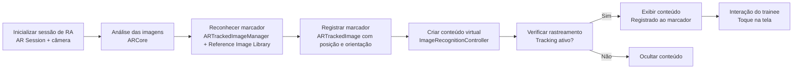
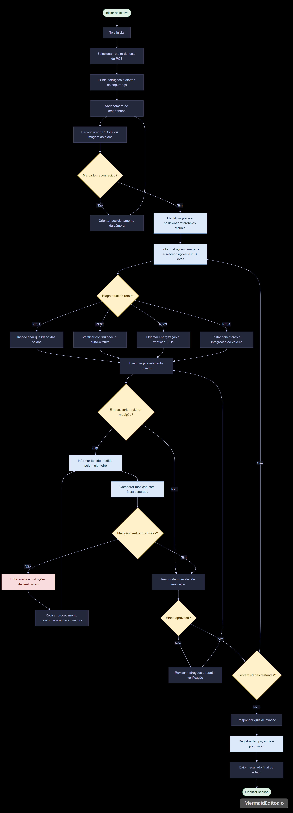
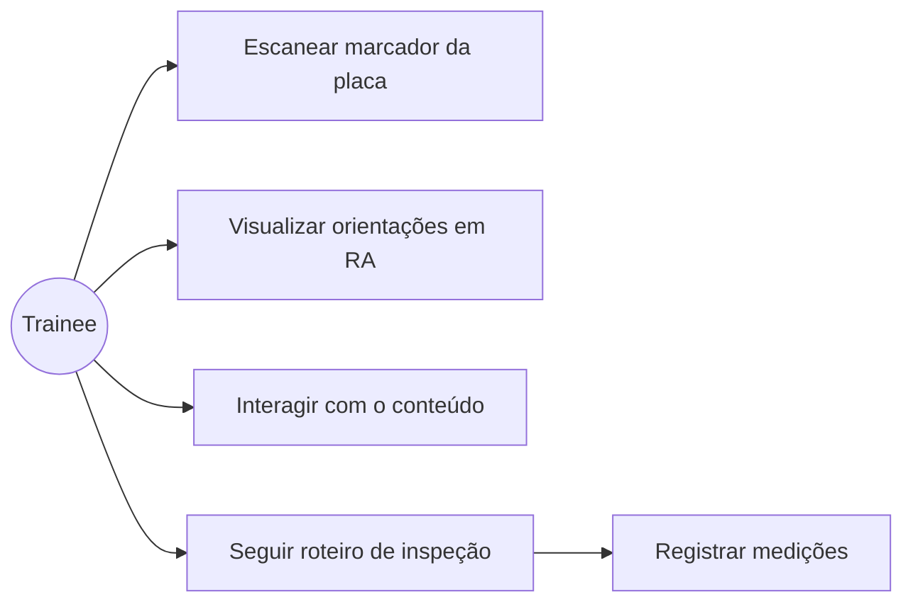
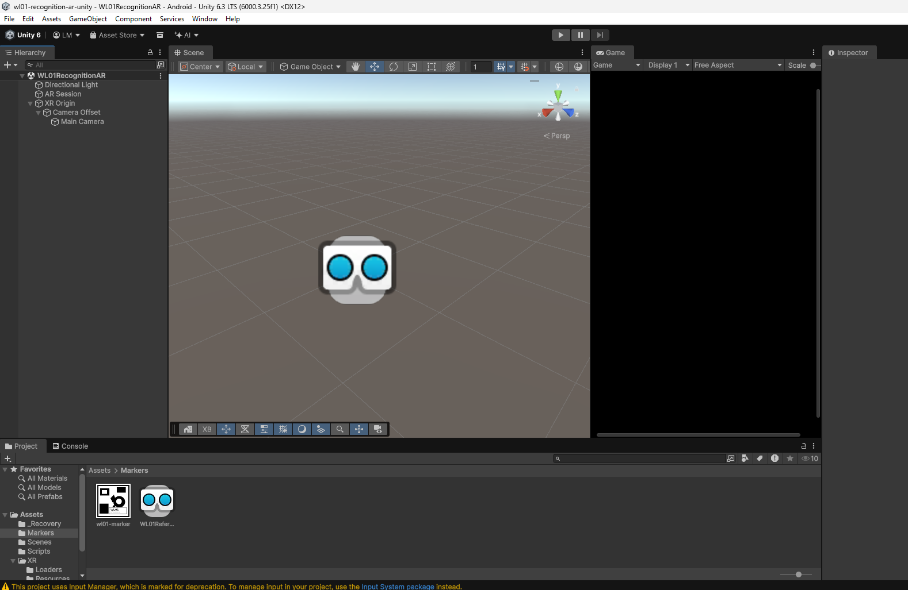

# AR Maintenance Guide

> **Projeto AR Academy — UPX: Realidade Aumentada**  
> Repositório sobre o modelo AR accademy para B'Energy desenvolvido pelo Grupo Overlay para capacitação e aprendizado na manutenção da placa PCB usando Realidade Aumentada


---

## 1. Identificação do Projeto

| Item | Informação |
|---|---|
| **Projeto** | B'Energy AR accademy |
| **Equipe** | Overlay |
| **Curso** | Engenharia da computação |
| **Disciplina** | UPX — Realidade Aumentada |
| **Professor** | Daniel Ohata |
| **Semestre** | 2026.2 |

### Integrantes

| Nome | RA | Responsabilidade |
|---|---|---|
| Felipe Roberto| 226752 | Desenvolvimento, Planejamento|
| Felipe Veronezzi | 252628 | Documentação, Planejamento |
| Gabriel Verlangieri | 222709 | Desenvolvimento,  X|
| André Vinicius | 236811 | Testes|
| Pedro Henrique | 236519 | Documentação, Planejamento |
| Gabriel Queiroz | 212065 | Testes |
| Matheus Rodrigues | 235959 | Documentação |
| Luis Felipe | 222287 | Desenvolvimento |

---

## 2. Visão Geral

O **B’Energy AR Academy** é um projeto acadêmico de aplicação móvel desenvolvido em Unity que utiliza Realidade Aumentada (RA) e QR Codes para dar suporte ao treinamento de trainees da equipe B’Energy Racing (FACENS) no desenvolvimento de veículos elétricos para a competição Fórmula SAE.

A proposta consiste em utilizar a câmera de um dispositivo móvel para reconhecer marcadores (QR Codes) posicionados junto aos componentes físicos do veículo e das placas eletrônicas (PCB/PCA). 

Após o reconhecimento, a aplicação apresenta informações técnicas sobre as funções dos componentes, orientações de segurança, questionários de fixação e um roteiro guiado de verificação de placas em quatro etapas (qualidade de soldagem, continuidade/curto-circuito, energização Bring UP e testes de integração).

Este repositório reúne a estrutura do Produto Mínimo Viável (MVP) do aplicativo, focado inicialmente no setor de Low Voltage & Data Acquisition. 
O projeto visa aproximar a teoria da prática no ambiente de oficina, proporcionando maior autonomia de aprendizado aos novos estudantes e reduzindo a dependência constante de membros veteranos.


---

## 3. Problema

O treinamento inicial de trainees e a verificação de sistemas técnicos frequentemente dependem de documentações extensas e da supervisão constante de membros veteranos, o que dificulta a associação direta entre o conteúdo teórico e os componentes físicos do veículo.

O B’Energy AR Academy soluciona esse problema ao utilizar Realidade Aumentada e QR Codes em dispositivos móveis para projetar orientações técnicas, avisos de segurança e roteiros de inspeção de placas eletrônicas (PCB) diretamente sobre as peças físicas.

Dessa forma, a aplicação aproxima a informação técnica do seu ponto de uso de maneira simples, promovendo a autonomia dos estudantes no aprendizado e reduzindo dúvidas operacionais no ambiente de oficina.

---

## 4. Objetivos

### 4.1 Objetivo Geral

Desenvolver uma aplicação de Realidade Aumentada capaz de reconhecer uma referência visual e apresentar informações virtuais relacionadas ao objeto identificado.

### 4.2 Objetivos Técnicos

- Configurar um projeto Unity com suporte a Realidade Aumentada.
- Utilizar AR Foundation como camada de integração.
- Realizar reconhecimento de uma imagem cadastrada.
- Instanciar um objeto 3D associado à imagem reconhecida.
- Permitir interação básica com o conteúdo virtual.
- Executar e testar a aplicação em um dispositivo móvel.
- Documentar instalação, execução, testes e limitações.

---

## 5. Público-Alvo

O B’Energy AR Academy é destinado aos trainees da equipe B’Energy Racing (FACENS), especialmente do setor de Low Voltage & Data Acquisition, que necessitam de orientação prática para inspecionar placas eletrônicas e realizar testes de validação e integração em veículos elétricos.

## 6. Funcionalidades

| ID | Funcionalidade | Descrição | Status |
|---|---|---|---|
| RF01 | Guia de soldagem | Exibe referências visuais para identificar soldas defeituosas em PCBs. | 🚧 |
| RF02 | Guia de continuidade | Destaca pontos de medição e circuitos para testes com multímetro. | 🚧 |
| RF03 | Guia de energização | Orienta o processo de Bring UP e indica o comportamento esperado dos LEDs. | 🚧 |
| RF04 | Guia de integração | Indica chaves, conectores e componentes utilizados nos testes do veículo. | 🚧 |
| RF05 | Navegação sequencial | Permite avançar e retornar entre as quatro etapas de inspeção. | 🚧 |
| RF06 | Checklist de validação | Exibe critérios de aprovação e instrumentos necessários para cada etapa. | 🚧 |
| RF07 | Registro de medições | Permite inserir valores de tensão e outras medições realizadas pelo trainee, conforme solicitado durante as etapas de inspeção e validação. | 🚧 |

**Legenda:** ✅ Implementado · 🚧 Em desenvolvimento · ⬜ Planejado · ❌ Cancelado
## 7. Requisitos Não Funcionais

| ID | Categoria | Requisito |
|---|---|---|
| RNF01 | Usabilidade | A interface deve ser intuitiva e dispensar treinamentos extensos. |
| RNF02 | Ergonomia | Deve permitir o uso em suportes de bancada, mantendo as mãos livres para a inspeção. |
| RNF03 | Clareza visual | As indicações devem apresentar contraste e legibilidade adequados à iluminação da bancada. |
| RNF04 | Desempenho | O reconhecimento de QR Codes e marcadores deve ocorrer rapidamente. |
| RNF05 | Rastreamento | As indicações de RA devem permanecer alinhadas aos pontos correspondentes da PCB. |
| RNF06 | Compatibilidade | A aplicação deve funcionar em dispositivos móveis compatíveis com a tecnologia de RA utilizada. |
| RNF07 | Processamento | O MVP deve priorizar textos, imagens e elementos visuais leves, evitando modelos 3D pesados. |
| RNF08 | Manutenibilidade | A estrutura deve facilitar a inclusão de novas rotinas e componentes. |
| RNF09 | Avaliação | O sistema deve permitir registrar métricas de uso, etapas concluídas e erros durante o treinamento. |

## 8. Tecnologias Utilizadas

| Tecnologia | Versão | Utilização |
|---|---|---|
| Unity | 6000.3.25f1 | Desenvolvimento principal |
| C# | Compatível com Unity 6000.3.25f1 | Scripts da aplicação |
| AR Foundation | 6.3.5 | Camada de abstração de Realidade Aumentada |
| ARCore XR Plugin | 6.3.5 | Recursos de Realidade Aumentada em Android |
| ARKit XR Plugin | 6.3.5 | Recursos de Realidade Aumentada em iOS |
| XR Plugin Management | 4.6.1 | Gerenciamento de plugins XR |
| Blender | 4.x | Modelagem/edição 3D |
| Git | 2.x | Controle de versão |
| GitHub | — | Hospedagem do projeto e documentação |

---

## 9. Hardware Utilizado

| Equipamento | Modelo | Característica relevante | Utilização |
|---|---|---|---|
| Smartphone | Samsung Galaxy S23 (SM-S911B) | Suporte ao ARCore, Android 10+ (API ≥ 29) | Execução e testes |
| Computador | Notebook Windows 11 Home | Intel Core i5-10300H, 24 GB RAM, NVIDIA GeForce GTX 1650 | Desenvolvimento e build |

---

## 10. Arquitetura do Sistema

A arquitetura do B'Energy AR Academy parte do repositório de referência **WL01 (Recognition AR / Image Tracking)** e está organizada em camadas: interface, controle da experiência, módulo de RA, framework XR e hardware do dispositivo.

```mermaid
flowchart TB
    USER["Trainee"]
    subgraph MOBILE["Aplicativo mobile — Unity 6000.x"]
        UI["Interface e navegação"]
        CAMERA["Câmera do smartphone"]
        TRACK["AR Foundation<br/>ARTrackedImageManager"]
        LIB["XR Reference Image Library"]
        RENDER["Renderização de referências 2D/3D"]
        GUIDE["Motor do roteiro de testes"]
        INPUT["Formulários e checklists"]
        VALIDATOR["Validação de medições"]
        METRICS["Métricas de execução e aprendizado"]
    end

    subgraph TOOLS["Ferramentas e ambiente"]
        ANDROID["Smartphone Android com ARCore"]
        BLENDER["Blender<br/>Edição de elementos gráficos"]
        GIT["Git e GitHub<br/>Versionamento do projeto"]
    end

    USER --> UI
    UI --> CAMERA
    CAMERA --> TRACK
    LIB --> TRACK
    TRACK --> RENDER
    RENDER --> GUIDE
    GUIDE --> INPUT
    INPUT --> VALIDATOR
    VALIDATOR --> GUIDE
    GUIDE --> METRICS
    ANDROID -. "Dispositivo de execução" .-> CAMERA
    BLENDER -. "Produção de recursos visuais" .-> RENDER
    GIT -. "Controle de versões" .-> UI
```



### Componentes da cena `WL01RecognitionAR`

```text
WL01RecognitionAR
├── Directional Light
├── AR Session                       → ciclo de vida da sessão de RA
└── XR Origin (Mobile AR)            → origem da experiência
    ├── AR Tracked Image Manager     → detecta e acompanha os marcadores
    ├── Image Recognition Controller → cria e atualiza o conteúdo virtual
    └── Camera Offset
        └── Main Camera              → câmera de RA
```

### Fluxo resumido

```text
Trainee
   ↓
Interface da Aplicação
   ↓
Controle da Experiência (ImageRecognitionController)
   ↓
AR Foundation (ARTrackedImageManager)
   ↓
ARCore
   ↓
Câmera / Sensores
   ↓
Ambiente Físico (placa PCB + marcador)
```

---

## 11. Funcionamento da Realidade Aumentada

### 11.1 Técnica utilizada

Utilizamos **Image Tracking**: uma imagem cadastrada na **XR Reference Image Library** (`Assets/Markers/WL01ReferenceImageLibrary.asset`) funciona como referência para ativar o conteúdo virtual. Na versão final, o marcador será a imagem da própria placa ou um QR Code fixado nela.

O marcador atual é o `wl01-marker.png`, cadastrado com tamanho físico de **0,12 m × 0,12 m**. Informar o tamanho físico permite que o ARCore estime corretamente a escala e a posição do conteúdo.

### 11.2 Fluxo técnico

1. A aplicação inicia a sessão de RA (`AR Session`) e a câmera do dispositivo.
2. O ARCore analisa continuamente as imagens capturadas.
3. O `ARTrackedImageManager` compara a imagem observada com a Reference Image Library.
4. Quando há correspondência, é criado um `ARTrackedImage` com a posição e a orientação do marcador.
5. O `ImageRecognitionController` cria o conteúdo virtual como filho do `ARTrackedImage`, mantendo-o registrado ao marcador.
6. Enquanto o estado for `Tracking`, o conteúdo fica visível; se o marcador for perdido, o conteúdo é ocultado.
7. O trainee interage com o conteúdo tocando na tela.

### 11.3 Elementos virtuais

| Elemento | Situação atual | Planejado para o MVP |
|---|---|---|
| Objeto 3D | Cubo de demonstração | Destaques leves sobre os pontos da placa |
| Texto de orientação | — | Instruções de cada etapa do roteiro |
| Destaque visual | — | Marcação de soldas e test points |
| Botão de ação | — | Avançar e voltar etapas (RF05) |
| Indicação de status | — | Etapa atual e checklist (RF06) |

---

## 12. Estrutura do Projeto

```text
AR_UPX_Project/
│
├── Assets/
│   ├── Markers/
│   │   ├── wl01-marker.png
│   │   └── WL01ReferenceImageLibrary.asset
│   ├── Scenes/
│   │   └── WL01RecognitionAR.unity
│   ├── Scripts/
│   │   ├── ImageRecognitionController.cs
│   │   └── TapToToggleScale.cs
│   └── XR/                (configurações do XR Plug-in Management)
│
├── Packages/
├── ProjectSettings/
│
├── docs/
│   ├── ARQUITETURA.md
│   ├── ATIVIDADE.md
│   └── CUSTOMIZACAO.md
│
├── .gitignore
└── README.md
```

### Pastas principais

| Pasta | Finalidade |
|---|---|
| `Assets/Markers` | Imagens de referência e a Reference Image Library |
| `Assets/Scenes` | Cenas da aplicação |
| `Assets/Scripts` | Scripts C# da aplicação |
| `Assets/XR` | Configurações do XR Plug-in Management (ARCore) |
| `docs` | Documentação complementar |

---

## 13. Principais Scripts

| Script | Responsabilidade |
|---|---|
| `ImageRecognitionController.cs` | Escuta os eventos do `ARTrackedImageManager` (imagens adicionadas, atualizadas e removidas), cria o conteúdo virtual sobre cada marcador reconhecido e o oculta quando o tracking é perdido. |
| `TapToToggleScale.cs` | Interação por toque: detecta o toque na tela via raycast e alterna a escala do objeto tocado (×1,5). |

Os dois scripts ficam em `Assets/Scripts/`, no namespace `Facens.WL01`.

---

## 14. Dependências

Dependências declaradas em `Packages/manifest.json`:

```text
com.unity.xr.arfoundation   6.3.5
com.unity.xr.arcore         6.3.5
com.unity.xr.arkit          6.3.5
com.unity.xr.management     4.6.1
```

---

## 15. Configuração do Ambiente

### Pré-requisitos

- Windows 10 ou 11;
- Unity Hub;
- Unity **6000.3.25f1** (Unity 6.3 LTS);
- módulo **Android Build Support** (com OpenJDK e Android SDK & NDK Tools);
- Git;
- smartphone Android compatível com ARCore e com **Android 10 ou superior**.

> O módulo Visual Studio do Unity Hub é opcional. Se o Visual Studio já estiver instalado, basta selecioná-lo em **Edit → Preferences → External Tools**.

### Procedimento

1. Instale o Unity Hub.
2. Instale o Unity 6000.3.25f1 com o módulo Android Build Support.
3. Instale o Git.
4. Clone o repositório em um caminho curto e sem acentos (ex.: `C:\AR\`).
5. Abra o projeto pelo Unity Hub e aguarde a importação dos pacotes.
6. Em **Edit → Project Settings → XR Plug-in Management**, aba Android, confirme que **ARCore** está marcado.
7. Em **Project Settings → Player → Android → Other Settings**, confirme:
   - **Minimum API Level:** Android 10.0 (API 29);
   - **Active Input Handling:** Both.

---

## 16. Como Executar

```bash
git clone https://github.com/lfmutton/AR_UPX_Project.git
```

Depois:

1. Abra o Unity Hub e clique em **Add / Open Project**.
2. Selecione a pasta clonada.
3. Abra a cena `Assets/Scenes/WL01RecognitionAR.unity`.
4. Abra **File → Build Profiles** (Ctrl+Shift+B), selecione **Android** e clique em **Switch Platform** se necessário.
5. Confirme que a cena `WL01RecognitionAR` está na **Scene List**.
6. No celular, ative as **Opções do desenvolvedor** e a **Depuração USB**.
7. Conecte o celular via USB e autorize a depuração.
8. Clique em **Build and Run**.

---

## 17. Como Utilizar a Aplicação

1. Abra a aplicação no dispositivo.
2. Autorize o acesso à câmera.
3. Aponte a câmera para o marcador impresso ou para a placa.
4. Aguarde o reconhecimento.
5. Observe o conteúdo virtual sobre o marcador.
6. Toque no objeto para alternar sua escala.

---

## 18. Fluxo de Funcionamento



---

## 19. Caso de Uso



---

## 20. Fluxo de Navegação

```text
Abertura do app
    ↓
Câmera (RA ativa)
    ↓
Reconhecimento do marcador
    ↓
Conteúdo Virtual
    ↓
Interação (toque)
```

No MVP, vamos adicionar uma tela inicial e a navegação entre as quatro etapas do roteiro de inspeção (RF05).

---

## 21. Interface

As imagens do projeto ficam em `docs/images/`:

```text
docs/images/
├── cena-unity.png
├── fluxo_funcionamento.png
├── imagem_teste.jpg
└── visao_geral.svg
```

| Arquivo | Conteúdo | Onde aparece |
|---|---|---|
| `cena-unity.png` | Cena `WL01RecognitionAR` montada no Unity | Seção 25 |
| `fluxo_funcionamento.png` | Fluxo de funcionamento da aplicação | Seção 18 |
| `visao_geral.svg` | Visão geral do projeto | Seção 2 |

---

## 22. Testes Técnicos

| Teste | Procedimento | Resultado esperado | Resultado obtido | Status |
|---|---|---|---|---|
| Build Android | Build and Run no Unity | APK gerado e instalado no celular | APK gerado e instalado no Galaxy S23 | ✅ |
| Inicialização | Abrir aplicativo | Aplicação inicia | Aplicação iniciou normalmente | ✅ |
| Câmera | Abrir aplicativo e permitir câmera | Câmera de RA é ativada | Câmera ativada após a permissão | ✅ |
| Image Tracking | Apontar para o marcador | Marcador é detectado | Marcador detectado | ✅ |
| Conteúdo 3D | Reconhecer o marcador | Cubo aparece sobre o marcador | Cubo exibido sobre o marcador | ✅ |
| Estabilidade | Mover o celular lentamente | Cubo permanece registrado ao marcador | Cubo manteve-se alinhado ao marcador | ✅ |
| Interação | Tocar no cubo | Escala alterna | Escala alternou ao toque | ✅ |

---

## 23. Dispositivos Testados

| Dispositivo | Sistema | Versão | Resultado |
|---|---|---|---|
| Samsung Galaxy S23 (SM-S911B) | Android | Preencher | ✅ Todos os testes aprovados |

---

## 24. Limitações Conhecidas

- o reconhecimento depende de boa iluminação e do marcador inteiro visível;
- é necessário um smartphone compatível com ARCore e com Android 10 ou superior;
- o conteúdo atual ainda é o cubo de demonstração do template WL01;
- os guias RF01 a RF07 ainda não foram implementados;
- o toque usa o Input Manager antigo, o que exige **Active Input Handling = Both** e gera um aviso no build Android.

---

## 25. Evidências de Funcionamento

- [✅] Captura de tela da cena no Unity



- [✅] Vídeo de 30 a 60 s mostrando reconhecimento, tracking e toque

[Assistir demonstração](https://facens-my.sharepoint.com/:v:/g/personal/222287_facens_br/IQDhc_5IWhQDRpW3ojZiLr4tAdURzoYrYbk4rNdl7FY4Zwc?e=xo273a&nav=eyJyZWZlcnJhbEluZm8iOnsicmVmZXJyYWxBcHAiOiJTdHJlYW1XZWJBcHAiLCJyZWZlcnJhbFZpZXciOiJTaGFyZURpYWxvZy1MaW5rIiwicmVmZXJyYWxBcHBQbGF0Zm9ybSI6IldlYiIsInJlZmVycmFsTW9kZSI6InZpZXcifX0%3D)

---

## 26. Repositórios e Recursos

| Recurso | Link |
|---|---|
| Código-fonte | https://github.com/lfmutton/AR_UPX_Project |
| Figma | https://www.figma.com/design/JEYjQr9279QAKvydvNqFS1/Untitled?node-id=0-1&p=f |
| Trello/Jira | https://trello.com/b/qlnUJc32/upx-realidade-aumentada-overlay |
| Vídeo | [Assistir demonstração](https://facens-my.sharepoint.com/:v:/g/personal/222287_facens_br/IQDhc_5IWhQDRpW3ojZiLr4tAdURzoYrYbk4rNdl7FY4Zwc?e=xo273a&nav=eyJyZWZlcnJhbEluZm8iOnsicmVmZXJyYWxBcHAiOiJTdHJlYW1XZWJBcHAiLCJyZWZlcnJhbFZpZXciOiJTaGFyZURpYWxvZy1MaW5rIiwicmVmZXJyYWxBcHBQbGF0Zm9ybSI6IldlYiIsInJlZmVycmFsTW9kZSI6InZpZXcifX0%3D) |
| Documentação complementar | [`docs/`](docs/) |

---

## 27. Cronograma Técnico

| Atividade | Responsável | Status |
|---|---|---|
| Configuração do projeto Unity + AR Foundation | Desenvolvimento | ✅ |
| Montagem da cena AR e Reference Image Library | Desenvolvimento | ✅ |
| Primeiro build em dispositivo físico | Desenvolvimento | ✅ |
| Troca do marcador pela imagem da PCB | Desenvolvimento | ⬜ |
| Guias RF01–RF04 | Desenvolvimento | ⬜ |
| Navegação, checklist e registro (RF05–RF07) | Desenvolvimento | ⬜ |
| Testes em dispositivo | Testes | 🚧 |
| Documentação | Documentação | 🚧 |

---

## 28. Controle de Versão

Seguimos o padrão de mensagens abaixo nos commits:

```text
feat: adiciona reconhecimento de imagem
fix: corrige posicionamento do objeto virtual
docs: atualiza instruções de execução
test: registra teste em dispositivo Android
```

Cada funcionalidade é registrada em commits separados, para que o histórico mostre a evolução do projeto.

---

## 29. Problemas Encontrados e Soluções

### Problema 1 — Build falha por API mínima do Android

**Problema:** `BuildFailedException: ARCore Required apps using Vulkan require a minimum SDK version of AndroidApiLevel29. Currently set to AndroidApiLevel25`.  
**Causa:** o ARCore com Vulkan exige Android 10 (API 29), e o projeto estava configurado com API 25.  
**Solução:** em **Player Settings → Android → Other Settings → Minimum API Level**, selecionamos **Android 10.0 (API level 29)**.

### Problema 2 — Aviso "Unsupported Input Handling on Android"

**Problema:** o Unity avisa que `Active Input Handling = Both` não é suportado no Android.  
**Causa:** o `TapToToggleScale` usa o Input Manager antigo, enquanto a câmera do XR Origin usa o Input System novo.  
**Solução:** mantivemos **Both** e escolhemos **Ignore** no aviso. Para removê-lo, será preciso migrar o `TapToToggleScale` para o Input System.

### Problema 3 — "No Android devices connected"

**Problema:** o Unity não encontrava o celular, mesmo conectado via USB.  
**Causa:** a Depuração USB não estava ativada no aparelho.  
**Solução:** ativamos as Opções do desenvolvedor (tocando 7 vezes em **Número de compilação**), ativamos a **Depuração USB** e autorizamos o computador.

### Problema 4 — Reference Image Library criada incorretamente

**Problema:** inicialmente foi criada uma pasta com o nome da library, em vez do asset.  
**Causa:** a Reference Image Library é um asset do Unity, não uma pasta.  
**Solução:** criamos a library via **Create → XR → Reference Image Library**, adicionamos a imagem e definimos o tamanho físico.

### Problema 5 — Falha ao instalar o módulo Visual Studio pelo Unity Hub

**Problema:** o Unity Hub retornava `INSTALL_ERROR` ao instalar o Visual Studio Community.  
**Causa:** o Visual Studio já estava instalado na máquina.  
**Solução:** ignoramos o módulo e selecionamos o Visual Studio existente em **Edit → Preferences → External Tools**.

---

## 30. Melhorias Futuras

- substituir o marcador de exemplo pela imagem da PCB ou por um QR Code;
- substituir o cubo por destaques leves e textos de orientação;
- implementar os guias RF01 a RF04 e a navegação sequencial (RF05);
- adicionar checklists (RF06) e registro de medições (RF07);
- registrar métricas de uso (tempo, erros e pontuação) — RNF09;
- migrar a interação por toque para o Input System.

---

## 31. Custos e Recursos

| Recurso | Tipo | Custo/Condição |
|---|---|---|
| Unity | Software | Licença Personal (gratuita) |
| Blender | Software | Gratuito |
| Smartphone | Hardware | Equipamento da equipe |
| Computador | Hardware | Equipamento da equipe |

---

## 32. Licença

Projeto acadêmico desenvolvido para fins educacionais na disciplina de UPX — Realidade Aumentada.

---

## 33. Autores

- **Felipe Roberto** — desenvolvimento e planejamento
- **Gabriel Verlangieri** — desenvolvimento
- **Luis Felipe** — desenvolvimento
- **Felipe Veronezzi** — documentação e planejamento
- **Pedro Henrique** — documentação e planejamento
- **Matheus Rodrigues** — documentação
- **André Vinicius** — testes
- **Gabriel Queiroz** — testes

**Instituição:** Centro Universitário FACENS  
**Disciplina:** UPX — Realidade Aumentada  
**Semestre:** 2026.2

---

## Checklist de Entrega

- [x] Código-fonte atualizado
- [x] README preenchido
- [x] Versões das tecnologias registradas
- [x] Arquitetura apresentada
- [x] Funcionamento da RA explicado
- [x] Estrutura de pastas documentada
- [x] Scripts principais descritos
- [x] Procedimento de instalação testado
- [x] Procedimento de execução testado
- [x] Screenshots reais adicionados
- [x] Testes registrados
- [x] Dispositivos testados informados
- [x] Limitações conhecidas documentadas
- [x] Evidência de funcionamento adicionada
- [x] Commits representam a evolução do projeto
