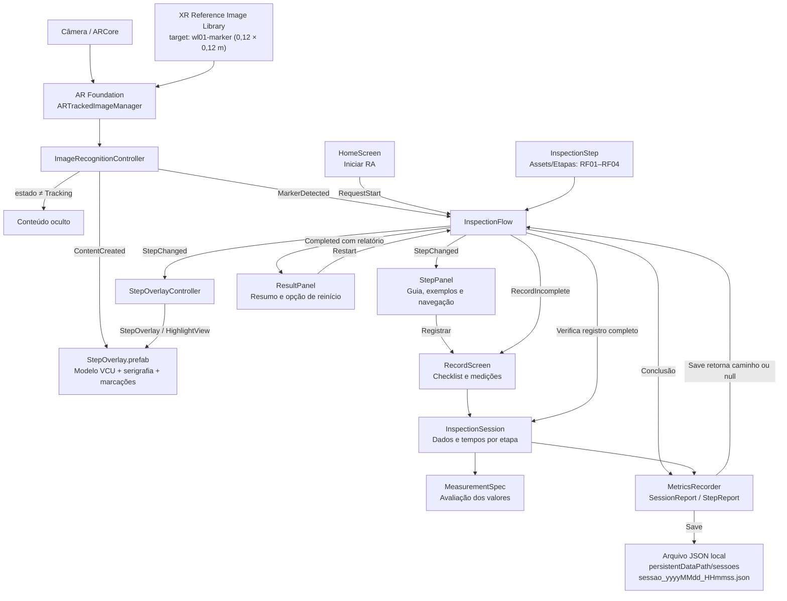
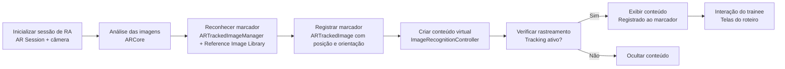
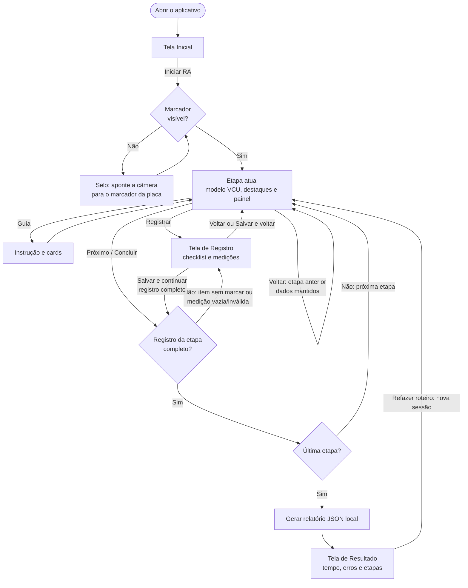
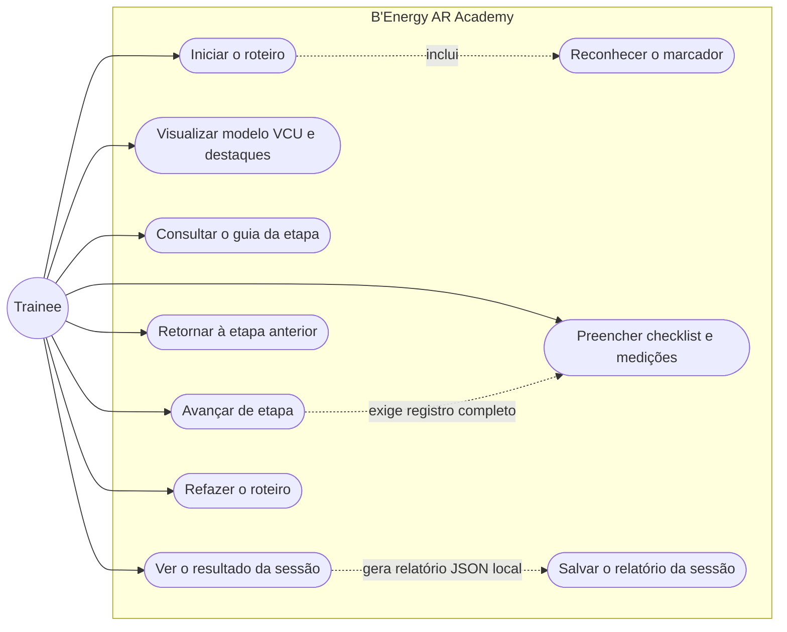
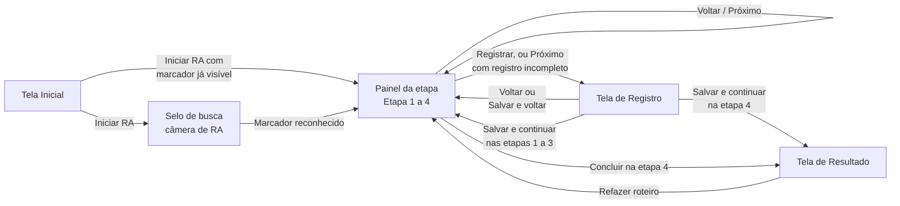
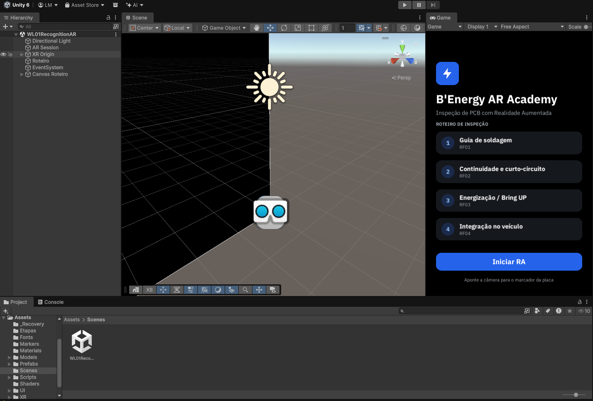

[README.md](https://github.com/user-attachments/files/34224229/README.md)# AR Maintenance Guide

> **Projeto AR Academy — UPX: Realidade Aumentada**  
> Repositório do B’Energy AR Academy, desenvolvido pela equipe Overlay para capacitação e aprendizado na inspeção de placas PCB usando Realidade Aumentada


---

## 1. Identificação do Projeto

| Item | Informação |
|---|---|
| **Projeto** | B’Energy AR Academy |
| **Equipe** | Overlay |
| **Curso** | Engenharia de Computação |
| **Disciplina** | UPX — Realidade Aumentada |
| **Professor** | Daniel Ohata |
| **Semestre** | 2026.2 |

### Integrantes

| Nome | RA | Responsabilidade |
|---|---|---|
| Felipe Roberto | 226752 | Desenvolvimento, Planejamento |
| Felipe Veronezzi | 252628 | Documentação, Planejamento |
| Gabriel Verlangieri | 222709 | Desenvolvimento |
| André Vinicius | 236811 | Testes |
| Pedro Henrique | 236519 | Documentação, Planejamento |
| Gabriel Queiroz | 212065 | Testes |
| Matheus Rodrigues | 235959 | Documentação |
| Luis Felipe | 222287 | Desenvolvimento |

**Identificações pendentes de confirmação.** Nomes e RAs da tabela acima foram mantidos como constam neste README; nenhum foi alterado por suposição. As divergências abaixo ainda precisam ser confirmadas pela equipe, e as funções devem ser conferidas com `MEMBROS_E_FUNCOES.md`.

| No README | Divergência registrada | Situação |
|---|---|---|
| Luis Felipe (RA 222287) | O artigo e o registro de equipe do planejamento citam "Luís Mutton". | Pendente de confirmação |
| Gabriel Queiroz (RA 212065) | O artigo lista "Gabriel Yamaya" entre os autores. | Pendente de confirmação |
| Pedro Henrique (RA 236519) | O artigo lista "Pedro Guimarães" e um registro de planejamento cita "Pedro Duarte". | Pendente de confirmação |
| Gabriel Verlangieri (RA 222709) | Registros de planejamento o identificam como "Gabriel Souza". A segunda função, antes marcada "X", não foi informada; permanece apenas "Desenvolvimento". | Pendente de confirmação |

---

## 2. Visão Geral

O **B’Energy AR Academy** é uma aplicação móvel acadêmica desenvolvida em Unity para apoiar o treinamento de trainees da equipe B’Energy Racing (FACENS) na execução de um roteiro de inspeção de placas eletrônicas (PCB), no contexto do setor de Low Voltage & Data Acquisition de veículos elétricos da competição Fórmula SAE.

A aplicação utiliza **Realidade Aumentada com Image Tracking**: a câmera reconhece uma imagem de referência cadastrada na XR Reference Image Library — na biblioteca analisada, o marcador `wl01-marker` (0,12 m × 0,12 m) — e, a partir dela, apresenta o conteúdo **VCU**: o modelo da placa com destaques dos pontos de observação e coleta de dados. O reconhecimento é feito por correspondência de imagem; a aplicação **não decodifica QR Codes** (ver [seção 11.4](#114-marcador-cadastrado-qr-code-e-serigrafia)). O roteiro reúne quatro etapas: qualidade de soldagem, continuidade e curto-circuito, energização (Bring UP) e integração.

Na versão atual, o usuário parte da tela inicial, aponta a câmera para a imagem cadastrada e percorre as quatro etapas: consulta orientações e exemplos, acompanha os pontos indicados no modelo, marca o checklist e insere as medições. O registro de cada etapa é obrigatório para avançar, e é possível retornar às etapas anteriores. Ao final, a aplicação apresenta o resultado da sessão, gera um relatório JSON local e permite refazer o roteiro. O uso está detalhado na [seção 17](#17-como-utilizar-a-aplicação), as funcionalidades na [seção 6](#6-funcionalidades) e a relação entre modelo, etapas, interface e dados na [seção 10](#10-arquitetura-do-sistema).

O foco principal do projeto é apoiar a **execução correta do roteiro de inspeção PCB**. A identificação dos componentes e a associação entre componente e função têm papel complementar. A contribuição esperada para o treinamento deverá ser avaliada com evidências de uso; a implementação do aplicativo, por si só, não demonstra redução de erros ou ganho de aprendizagem.


---

## 3. Problema

A execução de um roteiro de inspeção PCB exige relacionar a sequência das etapas às regiões da placa, às observações solicitadas, aos critérios do checklist e às medições que devem ser registradas. No contexto do treinamento de trainees, o desafio abordado pelo projeto é apresentar essas informações de forma vinculada à atividade e ao ponto correspondente da placa.

O B’Energy AR Academy propõe apoiar essa execução reunindo orientações, exemplos, destaques no modelo da placa e registros de cada etapa em uma aplicação móvel. A proposta busca facilitar o acompanhamento do roteiro e a organização dos dados da sessão.

Maior autonomia, redução de dúvidas e redução de erros são benefícios a investigar. Sua ocorrência no treinamento depende de avaliação com usuários e evidências do contexto de aplicação; este README descreve o recurso implementado e sua finalidade, sem apresentar esses benefícios como resultados já comprovados.

---

## 4. Objetivos

### 4.1 Objetivo Geral

Desenvolver uma aplicação móvel de Realidade Aumentada para apoiar trainees da B’Energy Racing na execução correta de um roteiro de inspeção PCB, apresentando orientações e exemplos associados ao modelo da placa e permitindo registrar checklists e medições ao longo das etapas.

### 4.2 Objetivos Técnicos

- Reconhecer uma imagem de referência por meio de Image Tracking com AR Foundation.
- Apresentar o modelo da placa VCU e destacar os pontos de observação e coleta de dados de cada etapa.
- Organizar o roteiro em quatro etapas: soldagem, continuidade/curto-circuito, energização e integração.
- Exibir orientações e exemplos que apoiem o acompanhamento do roteiro e, de forma complementar, a identificação dos componentes e de suas funções.
- Permitir navegação entre etapas, retorno e reinício do roteiro.
- Solicitar o preenchimento de checklists e a entrada de medições, indicando registros incompletos e a avaliação dos valores conforme a configuração da etapa.
- Apresentar o resumo da sessão e armazenar localmente os registros e tempos em relatório JSON.
- Documentar arquitetura, configuração, execução, evidências de funcionamento e limitações da aplicação.

Esses objetivos técnicos correspondem aos recursos descritos nas [funcionalidades](#6-funcionalidades) e na [arquitetura](#10-arquitetura-do-sistema). A avaliação da contribuição do aplicativo para a execução do roteiro e para a aprendizagem é uma finalidade da pesquisa, distinta da entrega desses recursos.

---

## 5. Público-Alvo

O público-alvo são os trainees da equipe **B’Energy Racing (FACENS)**, especialmente os envolvidos com **Low Voltage & Data Acquisition**, para os quais a aplicação oferece apoio visual e registro de dados durante o treinamento do roteiro de inspeção PCB.

O uso proposto combina a consulta às orientações e aos exemplos com a observação dos pontos indicados no modelo, a marcação dos itens de verificação e a entrada de medições. A execução de atividades na placa segue as instruções técnicas e as condições de acompanhamento definidas pela equipe responsável.

A definição do público-alvo descreve a destinação da aplicação; não estabelece quantidade de participantes, grupos de experimento ou resultados de avaliação.

---

## 6. Funcionalidades

O aplicativo apresenta o modelo da placa, destaca os pontos de coleta de dados e de observação, exibe orientações e exemplos e solicita o preenchimento de medições e checklists durante o roteiro. RF01–RF07 estão implementados, conforme confirmação de Felipe Roberto em 30/10/2026.

| ID | Funcionalidade | Descrição | Status |
|---|---|---|---|
| RF01 | Guia de soldagem | Apresenta orientações e exemplos de soldagem, com destaques no modelo da placa para apoiar a observação dos componentes e regiões indicadas. Fonte: [Etapa1_Soldagem.asset](Assets/Etapas/Etapa1_Soldagem.asset). | ✅ Implementado |
| RF02 | Guia de continuidade | Mostra no modelo os pontos de coleta de dados e apresenta orientações, checklist e campos de medição para a etapa de continuidade. Fonte: [Etapa2_Continuidade.asset](Assets/Etapas/Etapa2_Continuidade.asset). | ✅ Implementado |
| RF03 | Guia de energização | Apresenta orientações de Bring UP, pontos de observação e coleta de dados, checklist e entrada de medições. Fonte: [Etapa3_Energizacao.asset](Assets/Etapas/Etapa3_Energizacao.asset). | ✅ Implementado |
| RF04 | Guia de integração | Apresenta orientações e destaques dos componentes e pontos de observação no modelo da placa, acompanhados do checklist da etapa. Fonte: [Etapa4_Integracao.asset](Assets/Etapas/Etapa4_Integracao.asset). | ✅ Implementado |
| RF05 | Navegação sequencial | Permite iniciar, avançar, retornar e reiniciar o roteiro de quatro etapas. Fontes: [InspectionFlow.cs](Assets/Scripts/Roteiro/InspectionFlow.cs) e [StepPanel.cs](Assets/Scripts/UI/StepPanel.cs). | ✅ Implementado |
| RF06 | Checklist de validação | Solicita a marcação dos itens de verificação de cada etapa e indica os registros necessários antes de avançar. Fontes: [InspectionSession.cs](Assets/Scripts/Dados/InspectionSession.cs) e [RecordScreen.cs](Assets/Scripts/UI/RecordScreen.cs). | ✅ Implementado |
| RF07 | Registro de medições | Solicita a entrada de valores, apresenta unidades e avalia as medições conforme a configuração da etapa. Fontes: [RecordScreen.cs](Assets/Scripts/UI/RecordScreen.cs) e [MeasurementSpec.cs](Assets/Scripts/Dados/MeasurementSpec.cs). | ✅ Implementado |

**Legenda:** ✅ Implementado.

O modelo e os destaques por etapa são apresentados por [StepOverlay.prefab](Assets/Prefabs/Overlays/StepOverlay.prefab) e [StepOverlayController.cs](Assets/Scripts/AR/StepOverlayController.cs). Ao concluir o roteiro, o aplicativo apresenta o resultado e gera o relatório local da sessão por meio de [MetricsRecorder.cs](Assets/Scripts/Dados/MetricsRecorder.cs).

---

## 7. Requisitos Não Funcionais

| ID | Categoria | Requisito |
|---|---|---|
| RNF01 | Usabilidade | A interface deve ser intuitiva e dispensar treinamentos extensos. |
| RNF02 | Ergonomia | Deve permitir o uso em suportes de bancada, mantendo as mãos livres para a inspeção. |
| RNF03 | Clareza visual | As indicações devem apresentar contraste e legibilidade adequados à iluminação da bancada. |
| RNF04 | Desempenho | O reconhecimento de QR Codes e marcadores deve ocorrer rapidamente. |
| RNF05 | Rastreamento | As indicações de RA devem permanecer alinhadas aos pontos correspondentes da PCB. |
| RNF06 | Compatibilidade | A aplicação deve funcionar em dispositivos móveis compatíveis com a tecnologia de RA utilizada. |
| RNF07 | Processamento | O MVP deve priorizar textos, imagens e elementos visuais leves, evitando modelos 3D pesados. |
| RNF08 | Manutenibilidade | A estrutura deve facilitar a inclusão de novas rotinas e componentes. |
| RNF09 | Avaliação | O sistema deve permitir registrar métricas de uso, etapas concluídas e erros durante o treinamento. |

Na versão atual, o RNF09 está implementado por um relatório JSON local, gerado ao concluir o roteiro, com tempos, checklist, medições, erros e situação de cada etapa. O formato está na [seção 13](#formato-do-relatório-da-sessão), o significado de erros e aprovação na [seção 17.5](#175-resultado) e os limites de uso na [seção 24](#24-limitações-conhecidas). A implementação não indica validação em aparelho nem avaliação com usuários.

---

## 8. Tecnologias Utilizadas

| Tecnologia | Versão | Utilização |
|---|---|---|
| Unity | 6000.3.25f1 (revisão `e1dba0a9aba4`) | Desenvolvimento principal. Fonte: `ProjectSettings/ProjectVersion.txt`. |
| C# | Compatível com Unity 6000.3.25f1 | Scripts da aplicação |
| AR Foundation | 6.3.5 | Camada de abstração de Realidade Aumentada. Fonte: `Packages/manifest.json`. |
| ARCore XR Plugin | 6.3.5 | Recursos de Realidade Aumentada em Android (plataforma de execução e testes registrados). |
| ARKit XR Plugin | 6.3.5 | Pacote instalado para RA em iOS. A instalação não comprova funcionamento em iOS: não há build nem teste em iOS registrados neste projeto ([seção 14](#14-dependências)). |
| XR Plugin Management | 4.6.1 | Gerenciamento de plugins XR |
| Input System | 1.20.0 (dependência transitiva; fonte: `Packages/packages-lock.json`) | Entrada por toque/clique em `TapToToggleScale` (já migrado para o Input System). |
| Blender | 4.x | Modelagem/edição 3D |
| Git | 2.x | Controle de versão |
| GitHub | — | Hospedagem do projeto e documentação |

---

## 9. Hardware Utilizado

| Equipamento | Modelo | Característica relevante | Utilização |
|---|---|---|---|
| Smartphone | Samsung Galaxy S23 (SM-S911B) | Suporte ao ARCore; o projeto exige Android 10+ (API ≥ 29). **Versão do Android instalada: pendente** de registro pela Validação. | Dispositivo de execução do projeto |
| Computador | Notebook Windows 11 Home | Intel Core i5-10300H, 24 GB RAM, NVIDIA GeForce GTX 1650 | Desenvolvimento e build |

Os dados de aparelho e de versão do Android por execução dependem dos registros da Validação ([seção 23](#23-dispositivos-testados)); este README não infere testes além dos já registrados na [seção 22](#22-testes-técnicos).

---

## 10. Arquitetura do Sistema

O B’Energy AR Academy evoluiu da base WL01 de Image Tracking para um roteiro de inspeção com modelo da placa VCU, destaques por etapa, orientações e exemplos, checklist, entrada de medições e resultado da sessão. A arquitetura conecta reconhecimento de imagem, controle do roteiro, apresentação e registro de dados. O target de reconhecimento continua sendo o `wl01-marker` cadastrado na biblioteca; o modelo VCU é o conteúdo exibido sobre ele, e não a imagem reconhecida ([seção 11.4](#114-marcador-cadastrado-qr-code-e-serigrafia)).



As setas representam eventos, chamadas e uso de dados. As telas exibem o estado e encaminham ações; `InspectionFlow` controla a etapa atual, verifica a completude do registro e coordena a conclusão. `InspectionSession` mantém checklist, valores e tempos em memória; `MeasurementSpec` interpreta e avalia os valores. `MetricsRecorder` monta o relatório e tenta salvá-lo. `Save` retorna o caminho do arquivo ou `null` em caso de falha; `InspectionFlow` guarda esse retorno em `LastReportPath`, e `ResultPanel` o usa para informar se a gravação foi possível. O resultado é apresentado mesmo quando a gravação falha.

### Componentes da cena `WL01RecognitionAR`

A cena habilitada em [EditorBuildSettings.asset](ProjectSettings/EditorBuildSettings.asset) é [Assets/Scenes/WL01RecognitionAR.unity](Assets/Scenes/WL01RecognitionAR.unity). A árvore abaixo mostra os principais objetos e componentes; os itens entre colchetes são componentes anexados ao objeto, e os demais representam objetos da hierarquia:

```text
WL01RecognitionAR
├── Directional Light                → iluminação da cena
├── AR Session                       → ciclo de vida da sessão de RA
├── XR Origin                        → origem da experiência
│   ├── [ARTrackedImageManager]       → detecta e acompanha os marcadores
│   ├── [ImageRecognitionController]  → cria e atualiza o conteúdo virtual
│   └── Camera Offset
│       └── Main Camera              → câmera de RA
├── Roteiro
│   ├── [InspectionFlow]              → controla as quatro etapas e a sessão
│   └── [StepOverlayController]       → atualiza os destaques por etapa
├── Canvas Roteiro
│   ├── [HomeScreen]                  → controla o início do roteiro
│   ├── [StepPanel]                   → guia, exemplos, progresso e navegação
│   ├── [RecordScreen]                → checklist e entrada de medições
│   ├── [ResultPanel]                 → resumo e opção de reinício
│   ├── Tela Inicial                 → apresentação e botão Iniciar RA
│   ├── Tela Registro                → formulário de registro da etapa
│   └── Tela Resultado               → apresentação do resultado da sessão
└── EventSystem                      → interações da interface
```

O campo `contentPrefab` de `ImageRecognitionController` referencia `StepOverlay.prefab`; o cubo permanece como fallback quando não há prefab configurado. `InspectionFlow` referencia os quatro assets de `Assets/Etapas` e mantém `waitForStart` ativo, coordenando o botão inicial com o reconhecimento do marcador.

O prefab de conteúdo é instanciado como filho do marcador rastreado; portanto, o modelo e os destaques são posicionados em relação ao `wl01-marker`, e não detectados diretamente sobre a placa física. `StepOverlay` cria as marcações a partir dos dados da etapa, e `HighlightView` apresenta seus pontos e rótulos. A visibilidade do conteúdo acompanha o estado de tracking em `ImageRecognitionController`.

### Fluxo resumido

```text
Trainee
   ↓
Interface da Aplicação (tela inicial / Iniciar RA)
   ↓
Câmera / ARCore / AR Foundation (ARTrackedImageManager)
   ↓
Reconhecimento do marcador (ImageRecognitionController)
   ↓
Modelo VCU e destaques dos pontos da etapa
   ↓
Controle do roteiro (InspectionFlow)
   ↓
Guia, orientações e exemplos (StepPanel)
   ↓
Checklist e entrada de medições (RecordScreen)
   ↓
Verificação do registro (InspectionSession / MeasurementSpec)
   ↓
Navegação entre as quatro etapas
   ↓
Conclusão e relatório JSON (MetricsRecorder)
   ↓
Resultado da sessão (ResultPanel)
   ↓
Opção de refazer o roteiro (nova sessão)
```

Ao tentar avançar com o registro incompleto, o fluxo abre a tela de registro. Retornar à etapa anterior preserva os dados da sessão; refazer o roteiro cria uma nova sessão. O resultado utiliza os dados registrados e as regras de avaliação do aplicativo.

Os scripts de `Assets/Scripts/Editor` preparam a cena, os assets e o visual durante o desenvolvimento. Eles utilizam `UnityEditor` e não executam no aplicativo instalado; o aplicativo usa os componentes e assets já configurados.

---

## 11. Funcionamento da Realidade Aumentada

### 11.1 Técnica utilizada

Utilizamos **Image Tracking**: uma imagem cadastrada na **XR Reference Image Library** (`Assets/Markers/WL01ReferenceImageLibrary.asset`) funciona como referência (*target*) para ativar o conteúdo virtual. O ARCore compara as características visuais da imagem observada com as das imagens da biblioteca; o reconhecimento não depende de ler texto, URL ou código contido na imagem.

**Marcador cadastrado (configuração analisada, revisão `1b78aea`):**

| Item | Situação | Fonte |
|---|---|---|
| Target ativo | `wl01-marker` | [WL01ReferenceImageLibrary.asset](Assets/Markers/WL01ReferenceImageLibrary.asset); imagem em [wl01-marker.png](Assets/Markers/wl01-marker.png) |
| Tamanho físico configurado | **0,12 m × 0,12 m** | [WL01ReferenceImageLibrary.asset](Assets/Markers/WL01ReferenceImageLibrary.asset) |
| Conteúdo associado | Prefab `StepOverlay` (modelo VCU e destaques por etapa), referenciado no campo `contentPrefab` | [ImageRecognitionController.cs](Assets/Scripts/AR/ImageRecognitionController.cs); [StepOverlay.prefab](Assets/Prefabs/Overlays/StepOverlay.prefab) |
| `vcu-marker.png` | Serigrafia/textura do modelo VCU; **não** está cadastrada como target | [vcu-marker.png](Assets/Markers/vcu-marker.png); [ModelSetup.cs](Assets/Scripts/Editor/ModelSetup.cs) |
| Marcador final (planejado) | Imagem da própria placa ou QR Code fixado nela; **não implementado** nesta versão | — |

Informar o tamanho físico permite que o ARCore estime a escala e a distância do marcador. Para que a estimativa corresponda à configuração, a imagem deve ser impressa ou exibida com 12 cm de lado; outra dimensão tende a deslocar a escala e a posição do conteúdo.

### 11.2 Fluxo técnico

1. A aplicação inicia a sessão de RA (`AR Session`) e a câmera do dispositivo.
2. O ARCore analisa continuamente as imagens capturadas.
3. O `ARTrackedImageManager` compara a imagem observada com a Reference Image Library.
4. Quando há correspondência, é criado um `ARTrackedImage` com a posição e a orientação do marcador.
5. O `ImageRecognitionController` cria o conteúdo virtual como filho do `ARTrackedImage`, mantendo-o registrado ao marcador.
6. Enquanto o estado for `Tracking`, o conteúdo fica visível; se o marcador for perdido (estado diferente de `Tracking`), o conteúdo é ocultado.
7. O trainee segue o roteiro pelas telas do aplicativo (guia, registro e resultado). O toque para alternar a escala pertence ao objeto de demonstração ([seção 13](#13-principais-scripts)).

### 11.3 Elementos virtuais

| Elemento | Situação atual | Planejado para o MVP |
|---|---|---|
| Modelo da placa | Modelo VCU exibido no [prefab de overlay](Assets/Prefabs/Overlays/StepOverlay.prefab), com indicações associadas às etapas. | Contemplado na versão atual. |
| Texto de orientação e exemplos | Instruções e cartões de referência apresentados para apoiar a execução e a observação em cada etapa. Fontes: [Assets/Etapas](Assets/Etapas) e [StepPanel.cs](Assets/Scripts/UI/StepPanel.cs). | Contemplado na versão atual. |
| Destaque visual | Pontos de coleta de dados, componentes e regiões de observação indicados sobre o modelo da placa. Fonte: [StepOverlayController.cs](Assets/Scripts/AR/StepOverlayController.cs). | Contemplado na versão atual. |
| Botão de ação | Início, avanço, retorno e reinício do roteiro disponíveis nas telas. Fonte: [InspectionFlow.cs](Assets/Scripts/Roteiro/InspectionFlow.cs). | Contemplado na versão atual (RF05). |
| Indicação de status | Etapa atual, checklist, campos de medição e resumo do resultado apresentados pela interface. Fontes: [RecordScreen.cs](Assets/Scripts/UI/RecordScreen.cs) e [ResultPanel.cs](Assets/Scripts/UI/ResultPanel.cs). | Contemplado na versão atual (RF06 e RF07). |

### 11.4 Marcador cadastrado, QR Code e serigrafia

Para evitar ambiguidades, o projeto distingue os conceitos abaixo:

| Conceito | Definição | Situação no projeto |
|---|---|---|
| **Image Tracking** | Técnica que reconhece uma imagem de referência e rastreia sua posição e orientação. | Implementada com `ARTrackedImageManager` e a Reference Image Library. |
| **Target ativo** | Imagem efetivamente cadastrada na Reference Image Library. | `wl01-marker` (0,12 m × 0,12 m). |
| **Aparência de QR Code** | Imagem com padrão visual de QR Code usada apenas como imagem de referência. | Se cadastrada, é reconhecida como qualquer outra imagem, por suas características visuais; o conteúdo codificado é irrelevante para o reconhecimento. |
| **Serigrafia/textura do modelo** | Imagem aplicada ao modelo VCU para representar a placa. | `vcu-marker.png`; faz parte da aparência do conteúdo, não da lista de targets. |

A presença de um arquivo em `Assets/Markers` não comprova que ele seja target ativo: vale o que está cadastrado em `WL01ReferenceImageLibrary.asset`. Os requisitos RNF04 e RNF05 (seção 7) e o marcador final planejado (placa ou QR Code fixado nela) devem ser lidos nesse sentido: o QR Code funcionaria como imagem de referência, não como fonte de dados.

### 11.5 Destaques por etapa e perda de tracking

**Destaques por etapa.** Cada asset `InspectionStep` mantém a lista de destaques (`Highlight`) da etapa. Ao receber `StepChanged`, o `StepOverlayController` aplica esses destaques ao `StepOverlay` do conteúdo criado; o `HighlightView` posiciona cada ponto e rótulo segundo as coordenadas da etapa, e os destaques são limpos ao concluir o roteiro.

| Etapa | Destaques no modelo VCU | Fonte |
|---|---|---|
| 1 — Soldagem (RF01) | Componentes e regiões indicadas para observação. | [Etapa1_Soldagem.asset](Assets/Etapas/Etapa1_Soldagem.asset) |
| 2 — Continuidade (RF02) | Pontos de coleta de dados. | [Etapa2_Continuidade.asset](Assets/Etapas/Etapa2_Continuidade.asset) |
| 3 — Energização (RF03) | Pontos de observação e coleta de dados. | [Etapa3_Energizacao.asset](Assets/Etapas/Etapa3_Energizacao.asset) |
| 4 — Integração (RF04) | Componentes e pontos de observação. | [Etapa4_Integracao.asset](Assets/Etapas/Etapa4_Integracao.asset) |

**Perda de tracking.** A visibilidade do conteúdo acompanha o estado de tracking em `ImageRecognitionController`: quando o marcador deixa de ser rastreado, o modelo e os destaques são ocultados. Conforme a arquitetura da [seção 10](#10-arquitetura-do-sistema), checklist, valores e tempos ficam em `InspectionSession`, componente distinto do reconhecimento. Enquanto o conteúdo estiver oculto, não há destaque visível; o trainee deve reapontar a câmera para o marcador e seguir as instruções técnicas e de segurança da equipe (seção 5).

**Estágio de validação.** A correspondência espacial entre os destaques e os componentes da placa física depende da posição do marcador em relação à placa e **não foi validada**. A precisão do alinhamento, a estabilidade com o modelo VCU e as condições de reconhecimento (distância, ângulo e iluminação) aguardam as evidências de validação (DOC11/DOC14); este README não as declara como comprovadas.

---

## 12. Estrutura do Projeto

Estrutura dos principais arquivos e diretórios do repositório. Arquivos `.meta` e diretórios gerados pelo Unity foram omitidos para facilitar a leitura.

```text
AR_UPX_Project/
├── Assets/
│   ├── Etapas/
│   │   ├── Etapa1_Soldagem.asset
│   │   ├── Etapa2_Continuidade.asset
│   │   ├── Etapa3_Energizacao.asset
│   │   └── Etapa4_Integracao.asset
│   ├── Fonts/
│   ├── Markers/
│   │   ├── wl01-marker.png                  ← target cadastrado (0,12 m × 0,12 m)
│   │   ├── vcu-marker.png                   ← serigrafia/textura do modelo VCU (não é target)
│   │   └── WL01ReferenceImageLibrary.asset  ← lista de targets ativos
│   ├── Materials/
│   ├── Models/VCU/VCU.fbx
│   ├── Prefabs/Overlays/
│   │   ├── StepOverlay.prefab
│   │   └── DemoContent.prefab
│   ├── Scenes/WL01RecognitionAR.unity
│   ├── Scripts/
│   │   ├── AR/
│   │   │   ├── ImageRecognitionController.cs
│   │   │   ├── StepOverlayController.cs
│   │   │   ├── StepOverlay.cs
│   │   │   └── HighlightView.cs
│   │   ├── Roteiro/
│   │   │   ├── InspectionFlow.cs
│   │   │   └── InspectionStep.cs
│   │   ├── Dados/
│   │   │   ├── InspectionSession.cs
│   │   │   ├── MeasurementSpec.cs
│   │   │   └── MetricsRecorder.cs
│   │   ├── UI/
│   │   │   ├── HomeScreen.cs
│   │   │   ├── StepPanel.cs
│   │   │   ├── RecordScreen.cs
│   │   │   ├── ResultPanel.cs
│   │   │   ├── InfoCardView.cs
│   │   │   ├── ChecklistItemView.cs
│   │   │   ├── MeasurementFieldView.cs
│   │   │   └── StepResultRowView.cs
│   │   ├── Interacao/TapToToggleScale.cs
│   │   └── Editor/
│   │       ├── RoteiroSetup.cs
│   │       ├── OverlaySetup.cs
│   │       ├── RecordSetup.cs
│   │       ├── ModelSetup.cs
│   │       ├── VisualSetup.cs
│   │       └── RecordScreenSetup.cs
│   ├── Shaders/UISempreNaFrente.shader
│   ├── UI/Sprites/
│   └── XR/
├── Packages/
├── ProjectSettings/
├── docs/
│   ├── images/
│   ├── ARQUITETURA.md
│   ├── ATIVIDADE.md
│   └── CUSTOMIZACAO.md
├── .gitignore
└── README.md
```

### Pastas principais

| Pasta | Finalidade |
|---|---|
| `Assets/Etapas` | Assets `InspectionStep` com instruções, exemplos, destaques, checklist e especificações de medição das quatro etapas. |
| `Assets/Markers` | Biblioteca de reconhecimento e imagens. Na biblioteca analisada, o target cadastrado é `wl01-marker` (0,12 m × 0,12 m); `vcu-marker.png` é usada como serigrafia/textura do modelo VCU. A presença de uma imagem na pasta não significa que ela seja target ativo. |
| `Assets/Models/VCU` | Modelo 3D da placa utilizado pelo prefab de conteúdo. |
| `Assets/Materials` | Materiais do modelo, serigrafia e marcações. |
| `Assets/Prefabs/Overlays` | Prefab `StepOverlay` com modelo e estrutura de destaques; `DemoContent` preservado no repositório. |
| `Assets/Scenes` | Cena de RA e vínculos entre reconhecimento, roteiro e interface. |
| `Assets/Scripts/AR` | Reconhecimento, controle do conteúdo rastreado e apresentação dos destaques. |
| `Assets/Scripts/Roteiro` | Controle da sequência e definição dos dados de cada etapa. |
| `Assets/Scripts/Dados` | Estado da sessão, avaliação de valores, relatórios e persistência local. |
| `Assets/Scripts/UI` | Telas, painéis e componentes visuais de orientação, registro e resultado. |
| `Assets/Scripts/Interacao` | Interação por toque/clique do conteúdo de demonstração. |
| `Assets/Scripts/Editor` | Ferramentas de preparação no Editor; não integram a execução do aplicativo. |
| `Assets/Fonts`, `Assets/UI/Sprites` e `Assets/Shaders` | Fontes, elementos gráficos e shader das marcações. |
| `Assets/XR` | Configurações, loaders e recursos XR. |
| `Packages` e `ProjectSettings` | Dependências e configurações do projeto, incluindo cena de build e plataforma. |
| `docs` | Documentação complementar e imagens do projeto. |

Os documentos [ARQUITETURA.md](docs/ARQUITETURA.md), [ATIVIDADE.md](docs/ATIVIDADE.md) e [CUSTOMIZACAO.md](docs/CUSTOMIZACAO.md) preservam a arquitetura e as orientações da base didática WL01. Referências nesses arquivos à substituição do cubo ou à evolução inicial devem ser lidas nesse contexto histórico. As seções 10–13 deste README descrevem a arquitetura atual do roteiro com a placa VCU.

---

## 13. Principais Scripts

Os componentes do aplicativo usam o namespace `Facens.WL01`. As ferramentas de preparação usam `Facens.WL01.EditorTools` e ficam na pasta `Editor`, com acesso às APIs `UnityEditor`.

| Script | Responsabilidade |
|---|---|
| [ImageRecognitionController.cs](Assets/Scripts/AR/ImageRecognitionController.cs) | Recebe mudanças das imagens rastreadas, instancia o prefab sobre o marcador, controla sua visibilidade e emite MarkerDetected e ContentCreated. Sem prefab, cria o cubo de fallback. |
| [StepOverlayController.cs](Assets/Scripts/AR/StepOverlayController.cs) | Escuta ContentCreated, StepChanged e Finished; aplica os destaques da etapa ao conteúdo criado e os limpa ao concluir o roteiro. |
| [StepOverlay.cs](Assets/Scripts/AR/StepOverlay.cs) | Cria e remove as marcações visuais a partir da lista de Highlight da etapa. |
| [HighlightView.cs](Assets/Scripts/AR/HighlightView.cs) | Posiciona cada ponto e rótulo segundo as coordenadas da etapa e aplica seu estilo visual. |
| [InspectionFlow.cs](Assets/Scripts/Roteiro/InspectionFlow.cs) | Coordena início, etapas, avanço condicionado ao registro completo, retorno e reinício; monta/salva o relatório via MetricsRecorder e publica o resultado. |
| [InspectionStep.cs](Assets/Scripts/Roteiro/InspectionStep.cs) | Define o ScriptableObject da etapa: requisito, instrução, cartões InfoCard, destaques Highlight, checklist e medições. Os quatro assets ficam em Assets/Etapas. |
| [InspectionSession.cs](Assets/Scripts/Dados/InspectionSession.cs) | Mantém checklist, valores e tempos por etapa em memória; verifica registro completo e aprovação. Uma nova execução cria uma nova sessão. |
| [MeasurementSpec.cs](Assets/Scripts/Dados/MeasurementSpec.cs) | Define rótulo, unidade e faixa opcional; interpreta números e classifica valores como vazio, inválido, sem faixa, dentro ou fora. |
| [MetricsRecorder.cs](Assets/Scripts/Dados/MetricsRecorder.cs) | Define os relatórios SessionReport, StepReport e MeasurementReport; consolida os registros e salva JSON em Application.persistentDataPath/sessoes, retornando caminho ou null em falha. |
| [HomeScreen.cs](Assets/Scripts/UI/HomeScreen.cs) | Apresenta a tela inicial e solicita o início do roteiro ao pressionar Iniciar RA. |
| [StepPanel.cs](Assets/Scripts/UI/StepPanel.cs) | Mostra a etapa, progresso, instruções e cartões; alterna o Guia, abre Registrar e encaminha avanço/retorno ao fluxo. |
| [RecordScreen.cs](Assets/Scripts/UI/RecordScreen.cs) | Apresenta checklist e campos da etapa, atualiza a contagem de pendências e encaminha as entradas à sessão; ao concluir o registro, solicita o avanço. |
| [ResultPanel.cs](Assets/Scripts/UI/ResultPanel.cs) | Apresenta duração, erros, situação das etapas e resultado do salvamento; permite refazer o roteiro. |
| [InfoCardView.cs](Assets/Scripts/UI/InfoCardView.cs) | Apresenta título e texto de um cartão de orientação ou exemplo. |
| [ChecklistItemView.cs](Assets/Scripts/UI/ChecklistItemView.cs) | Associa o texto e a marcação de um item à ação de atualização do checklist. |
| [MeasurementFieldView.cs](Assets/Scripts/UI/MeasurementFieldView.cs) | Apresenta rótulo, unidade, entrada e avaliação da medição; comunica alterações do valor ao registro. |
| [StepResultRowView.cs](Assets/Scripts/UI/StepResultRowView.cs) | Apresenta a identificação e o estado de aprovação de uma etapa no resultado. |
| [TapToToggleScale.cs](Assets/Scripts/Interacao/TapToToggleScale.cs) | Detecta toque ou clique via Input System e raycast para alternar a escala do objeto de demonstração. |
| [RoteiroSetup.cs](Assets/Scripts/Editor/RoteiroSetup.cs) | Ferramenta do Editor que cria os assets iniciais das etapas e monta a interface do roteiro na cena aberta. |
| [OverlaySetup.cs](Assets/Scripts/Editor/OverlaySetup.cs) | Ferramenta do Editor que prepara o prefab e os componentes das marcações sobre a placa. |
| [RecordSetup.cs](Assets/Scripts/Editor/RecordSetup.cs) | Ferramenta histórica de montagem do checklist e medições no painel. Na estrutura atual, informa a substituição pelo menu da Fase 9 quando o campo antigo não existe. |
| [ModelSetup.cs](Assets/Scripts/Editor/ModelSetup.cs) | Ferramenta do Editor que insere e configura o modelo VCU no prefab, além da textura/serigrafia e dos materiais das marcações. |
| [VisualSetup.cs](Assets/Scripts/Editor/VisualSetup.cs) | Ferramenta do Editor que aplica o visual, configura elementos da interface, fonte e ajustes do registro. |
| [RecordScreenSetup.cs](Assets/Scripts/Editor/RecordScreenSetup.cs) | Ferramenta do Editor que monta a tela separada de registro, conecta seus campos e remove o quiz do fluxo preparado na cena. |

### Relação entre etapa, modelo, registro e resultado

1. `HomeScreen` solicita o início; `ImageRecognitionController` informa o reconhecimento e cria o conteúdo configurado.
2. `InspectionFlow` seleciona um `InspectionStep`. Os dados vêm do asset correspondente em `Assets/Etapas`.
3. `StepPanel` apresenta a orientação e os exemplos; `StepOverlayController` aplica os pontos dessa etapa ao `StepOverlay` do modelo.
4. `RecordScreen` apresenta os itens e campos; as respostas são mantidas em `InspectionSession` e as medições avaliadas por `MeasurementSpec`.
5. Ao concluir a última etapa, `InspectionFlow` usa `MetricsRecorder` para montar e tentar gravar o relatório; em seguida emite `Completed`, recebido por `ResultPanel`, mesmo que a gravação tenha falhado.

Os menus dos scripts `Editor` registram etapas de preparação do projeto. A cena já contém os componentes configurados; esses menus não são passos executados pelo usuário no celular.

### Formato do relatório da sessão

As classes abaixo estão em [MetricsRecorder.cs](Assets/Scripts/Dados/MetricsRecorder.cs). `MetricsRecorder.Build` as preenche a partir de `InspectionSession` e dos assets das etapas, e `MetricsRecorder.Save` as grava com `JsonUtility`.

**`SessionReport`: a sessão**

| Campo | Tipo | Conteúdo |
|---|---|---|
| `inicio` | texto | Data e hora locais do aparelho em que a sessão foi criada, no formato `yyyy-MM-ddTHH:mm:ss`, sem fuso horário. |
| `fim` | texto | Data e hora locais da conclusão, no mesmo formato. |
| `duracaoSegundos` | número | Tempo entre o início do roteiro e a conclusão. A Tela Inicial e a busca inicial pelo marcador não contam. |
| `erros` | inteiro | Itens de checklist sem marcar, somados às medições `Fora` e `Invalido` ([seção 17.5](#175-resultado)). |
| `etapas` | lista de `StepReport` | Uma entrada por etapa, na ordem do roteiro. |

**`StepReport`: uma etapa**

| Campo | Tipo | Conteúdo |
|---|---|---|
| `etapa` | texto | Título definido no asset da etapa. |
| `requisito` | texto | Requisito associado (RF01 a RF04). |
| `duracaoSegundos` | número | Soma do tempo de todas as passagens pela etapa, incluindo a Tela de Registro. O contador não para quando o marcador sai do enquadramento e o código não trata pausas do aplicativo. |
| `checklistMarcados` e `checklistTotal` | inteiros | Quantidade de itens marcados e total de itens. O relatório guarda só as contagens, não quais itens foram marcados. |
| `medicoes` | lista de `MeasurementReport` | Medições da etapa; a lista fica vazia nas etapas sem medição. |
| `aprovada` | verdadeiro ou falso | Resultado de `InspectionSession.IsApproved` ([seção 17.5](#175-resultado)). |

**`MeasurementReport`: uma medição**

| Campo | Tipo | Conteúdo |
|---|---|---|
| `medicao` | texto | Rótulo definido no asset. Marcadores como `[preencher]` aparecem no arquivo enquanto estiverem no asset. |
| `valor` | texto | Valor como foi digitado, com vírgula ou ponto. |
| `unidade` | texto | Unidade definida no asset. |
| `resultado` | texto | Classificação de [MeasurementSpec.cs](Assets/Scripts/Dados/MeasurementSpec.cs): `Vazio`, `Invalido`, `SemFaixa`, `Dentro` ou `Fora`. |

O formato não tem campo de participante, grupo, consentimento, aparelho, versão do aplicativo ou revisão do código, nem pontuação de quiz. Também não registra tentativas de avanço bloqueadas, retornos ou valores corrigidos: ele mostra só o estado final de cada etapa.

**Exemplo sintético.** Os valores e as datas abaixo foram inventados só para ilustrar o formato, com etapas e rótulos dos assets atuais. Não vêm de um teste, não descrevem uma placa real e não contêm dados pessoais. O nome de arquivo correspondente seria `sessao_20000101_100500.json`.

```json
{
    "inicio": "2000-01-01T10:00:00",
    "fim": "2000-01-01T10:05:00",
    "duracaoSegundos": 300.0,
    "erros": 1,
    "etapas": [
        {
            "etapa": "Guia de soldagem",
            "requisito": "RF01",
            "duracaoSegundos": 60.0,
            "checklistMarcados": 3,
            "checklistTotal": 3,
            "medicoes": [],
            "aprovada": true
        },
        {
            "etapa": "Continuidade e curto-circuito",
            "requisito": "RF02",
            "duracaoSegundos": 70.0,
            "checklistMarcados": 2,
            "checklistTotal": 2,
            "medicoes": [
                {
                    "medicao": "Resistência TP2–GND [preencher]",
                    "valor": "120",
                    "unidade": "Ω",
                    "resultado": "SemFaixa"
                }
            ],
            "aprovada": true
        },
        {
            "etapa": "Energização / Bring UP",
            "requisito": "RF03",
            "duracaoSegundos": 110.0,
            "checklistMarcados": 2,
            "checklistTotal": 2,
            "medicoes": [
                {
                    "medicao": "Tensão no trilho de 5 V (exemplo)",
                    "valor": "5,40",
                    "unidade": "V",
                    "resultado": "Fora"
                },
                {
                    "medicao": "Corrente consumida [preencher]",
                    "valor": "250",
                    "unidade": "mA",
                    "resultado": "SemFaixa"
                }
            ],
            "aprovada": false
        },
        {
            "etapa": "Integração no veículo",
            "requisito": "RF04",
            "duracaoSegundos": 60.0,
            "checklistMarcados": 3,
            "checklistTotal": 3,
            "medicoes": [],
            "aprovada": true
        }
    ]
}
```

Neste exemplo, o valor `5,40` fica fora da faixa de exemplo de 4,75 a 5,25 V, o que gera `erros: 1` e `aprovada: false` na etapa 3. As medições `SemFaixa` não são avaliadas, por isso não geram erro.

---

## 14. Dependências

Dependências declaradas em `Packages/manifest.json` (o arquivo declara somente estas quatro; as versões foram conferidas em `Packages/packages-lock.json`):

```text
com.unity.xr.arfoundation   6.3.5
com.unity.xr.arcore         6.3.5
com.unity.xr.arkit          6.3.5
com.unity.xr.management     4.6.1
```

**ARKit e iOS.** O `com.unity.xr.arkit` está instalado e há configurações de ARKit no projeto (`UnityEditor.XR.ARKit.ARKitSettings` em `ProjectSettings/EditorBuildSettings.asset`; símbolo `UNITY_XR_ARKIT_LOADER_ENABLED` para iPhone e `iOSTargetOSVersionString: 15.0` em `ProjectSettings/ProjectSettings.asset`). Isso não comprova iOS validado: o campo `cameraUsageDescription` está vazio no mesmo arquivo e não há build nem teste em iOS registrados. A plataforma documentada e testada é **Android**.

**Input System.** O `TapToToggleScale` usa o Input System (`com.unity.inputsystem`). O pacote não está declarado em `manifest.json`: entra como dependência transitiva do `com.unity.xr.arfoundation` e está resolvido em `Packages/packages-lock.json` na versão **1.20.0**.

---

## 15. Configuração do Ambiente

### Pré-requisitos

- Windows 10 ou 11;
- Unity Hub;
- Unity **6000.3.25f1** (Unity 6.3 LTS), conforme `ProjectSettings/ProjectVersion.txt`;
- módulo **Android Build Support** (com OpenJDK e Android SDK & NDK Tools);
- Git;
- smartphone Android compatível com ARCore e com **Android 10 ou superior**.

> O módulo Visual Studio do Unity Hub é opcional. Se o Visual Studio já estiver instalado, basta selecioná-lo em **Edit → Preferences → External Tools**.

### Procedimento

1. Instale o Unity Hub.
2. Instale o Unity 6000.3.25f1 com o módulo Android Build Support.
3. Instale o Git.
4. Clone o repositório em um caminho curto e sem acentos (ex.: `C:\AR\`).
5. Abra o projeto pelo Unity Hub e aguarde a importação dos pacotes.
6. Em **Edit → Project Settings → XR Plug-in Management**, aba Android, confirme que **ARCore** está marcado.
7. Em **Project Settings → Player → Android → Other Settings**, confirme:
   - **Minimum API Level:** Android 10.0 (API 29);
   - **Active Input Handling:** Both (`activeInputHandler: 2` em `ProjectSettings/ProjectSettings.asset`). Essa configuração permanece ativa mesmo com `TapToToggleScale` já migrado para o Input System (ver [problema 2](#problema-2--aviso-unsupported-input-handling-on-android)).

### Configuração local conferida

| Item | Valor | Fonte |
|---|---|---|
| Unity | 6000.3.25f1 (revisão `e1dba0a9aba4`) | `ProjectSettings/ProjectVersion.txt` |
| Cena habilitada no build | `Assets/Scenes/WL01RecognitionAR.unity` (única cena listada e habilitada) | `ProjectSettings/EditorBuildSettings.asset` |
| Minimum API Level (Android) | Android 10 (API 29) — `AndroidMinSdkVersion: 29` | `ProjectSettings/ProjectSettings.asset` |
| Target API Level (Android) | Automático — `AndroidTargetSdkVersion: 0` | `ProjectSettings/ProjectSettings.asset` |
| Arquitetura Android | ARM64 — `AndroidTargetArchitectures: 2` | `ProjectSettings/ProjectSettings.asset` |
| Active Input Handling | Both — `activeInputHandler: 2` | `ProjectSettings/ProjectSettings.asset` |
| Identificação do app | `productName`: `wl01-recognition-ar-unity`; pacote Android: `com.DefaultCompany.wl01recognitionarunity`; versão `1.0` (código 1) | `ProjectSettings/ProjectSettings.asset` |
| Pacotes XR | AR Foundation, ARCore e ARKit 6.3.5; XR Management 4.6.1 | `Packages/manifest.json`; `Packages/packages-lock.json` |
| Input System | 1.20.0 (dependência transitiva) | `Packages/packages-lock.json` |

Esses valores descrevem a configuração do repositório; não substituem o registro de dispositivo e versão do Android de cada execução ([seção 23](#23-dispositivos-testados)).

---

## 16. Como Executar

```bash
git clone https://github.com/lfmutton/AR_UPX_Project.git
```

Depois:

1. Abra o Unity Hub e clique em **Add / Open Project**.
2. Selecione a pasta clonada.
3. Abra a cena `Assets/Scenes/WL01RecognitionAR.unity`.
4. Abra **File → Build Profiles** (Ctrl+Shift+B), selecione **Android** e clique em **Switch Platform** se necessário.
5. Confirme que a cena `WL01RecognitionAR` está na **Scene List**. Em `ProjectSettings/EditorBuildSettings.asset` ela é a única cena listada e está habilitada.
6. No celular, ative as **Opções do desenvolvedor** e a **Depuração USB**.
7. Conecte o celular via USB e autorize a depuração.
8. Clique em **Build and Run**.

O build documentado é para **Android**. Os menus dos scripts de `Assets/Scripts/Editor` (`RoteiroSetup`, `OverlaySetup`, `ModelSetup`, `VisualSetup`, `RecordScreenSetup`) servem para recriar a cena, os assets e o visual durante o desenvolvimento; a cena e os assets do repositório já estão configurados, e **não é necessário executá-los para compilar ou rodar o aplicativo**. `RecordSetup` é ferramenta histórica, substituída pelo `RecordScreenSetup`.

---

## 17. Como Utilizar a Aplicação

Esta seção descreve o fluxo implementado em [InspectionFlow.cs](Assets/Scripts/Roteiro/InspectionFlow.cs), [RecordScreen.cs](Assets/Scripts/UI/RecordScreen.cs) e [StepPanel.cs](Assets/Scripts/UI/StepPanel.cs). As funcionalidades estão na [seção 6](#6-funcionalidades); a documentação das evidências acompanha as seções 22–25.

### 17.1 Início

1. Abra a aplicação e, se o Android solicitar, autorize o acesso à câmera.
2. Na **Tela Inicial**, confira as quatro etapas do roteiro e toque em **Iniciar RA**.
3. Aponte a câmera para o marcador, seguindo o selo "Aponte a câmera para o marcador da placa". O marcador cadastrado atualmente é o `wl01-marker.png`, da [Reference Image Library](Assets/Markers/WL01ReferenceImageLibrary.asset).
4. Ao reconhecer o marcador, o roteiro começa na etapa 1, com o modelo da placa VCU e os destaques da etapa. Se o marcador já estiver visível ao tocar em **Iniciar RA**, o roteiro começa imediatamente.

Se o marcador sair do enquadramento, o modelo e os destaques ficam ocultos até ele ser reconhecido novamente. O painel e os dados da etapa continuam disponíveis.

O marcador deve estar impresso ou exibido com **12 cm × 12 cm**, em superfície plana, sem reflexos e bem iluminada, posicionado conforme a orientação da equipe responsável. Não use `vcu-marker.png` como marcador: ela é a serigrafia do modelo e não está cadastrada como target.

### 17.2 As quatro etapas

| Etapa | Requisito | Itens de checklist | Medições |
|---|---|---|---|
| 1. Soldagem | RF01 | 3 | Nenhuma |
| 2. Continuidade e curto-circuito | RF02 | 2 | Resistência entre TP2 e GND (Ω), sem faixa definida |
| 3. Energização / Bring UP | RF03 | 2 | Tensão no trilho de 5 V (V), com faixa de exemplo de 4,75 a 5,25 V; corrente consumida (mA), sem faixa definida |
| 4. Integração | RF04 | 3 | Nenhuma |

Os itens e as medições são definidos nos assets de [Assets/Etapas](Assets/Etapas). Em cada etapa, o painel inferior abre minimizado para não cobrir o modelo e mostra a etapa atual, a barra de progresso, o título e os botões:

| Botão | Ação |
|---|---|
| **Guia** | Mostra ou recolhe a instrução e os cards de exemplo da etapa. |
| **Registrar (N pendentes)** | Abre a Tela de Registro. Passa a exibir **Registro completo** quando não há pendências. |
| **Voltar** | Retorna à etapa anterior. Fica desativado na etapa 1. |
| **Próximo** / **Concluir** | Avança de etapa; na etapa 4, conclui o roteiro. Só avança com o registro completo. |

### 17.3 Registro obrigatório

Na **Tela de Registro**, marque os itens do checklist e digite as medições, usando vírgula ou ponto como separador decimal. A tela informa quantos itens faltam, e os dados são guardados na sessão à medida que são preenchidos.

Para avançar, todo o checklist da etapa precisa estar marcado e toda medição precisa ter um valor numérico. Tocar em **Próximo** ou **Concluir** com pendências não avança e abre a Tela de Registro. A regra está em `InspectionSession.IsRecordComplete` ([InspectionSession.cs](Assets/Scripts/Dados/InspectionSession.cs)), e a avaliação dos valores em [MeasurementSpec.cs](Assets/Scripts/Dados/MeasurementSpec.cs):

| Situação | Indicação na tela | Impede avançar? | Efeito no resultado |
|---|---|---|---|
| Item do checklist sem marcar | Contagem "Faltam N itens" | **Sim** | Não chega ao resultado |
| Medição vazia | Contagem "Faltam N itens" | **Sim** | Não chega ao resultado |
| Medição inválida (não numérica) | "Valor inválido" e contagem de pendências | **Sim** | Não chega ao resultado |
| Valor dentro da faixa | "Dentro do esperado" | Não | Etapa sem erro por essa medição |
| Valor **fora da faixa** | "Fora da faixa esperada" | **Não** | Conta 1 erro e a etapa aparece como **Revisar** |
| Valor numérico em medição sem faixa | Aviso de faixa esperada a definir | Não | Registrado no relatório, sem avaliação |

Os botões da Tela de Registro são:

- **Salvar e continuar:** aparece com o registro completo, fecha a tela e avança; na etapa 4, conclui o roteiro.
- **Salvar e voltar:** aparece com o registro incompleto e retorna ao painel, mantendo o que foi preenchido.
- **Voltar (‹):** retorna ao painel sem avançar, também mantendo o que foi preenchido.

### 17.4 Retorno entre etapas

**Voltar** não exige registro completo e mantém os dados da sessão. Se um item ou uma medição de uma etapa anterior for alterado e deixar o registro incompleto, é preciso completá-lo novamente para seguir em frente.

### 17.5 Resultado

Ao concluir a etapa 4 com o registro completo, a **Tela de Resultado** apresenta:

- o tempo da sessão (mm:ss);
- o número de erros;
- cada etapa como **Aprovada** ou **Revisar**;
- a confirmação de que o relatório foi salvo, ou o aviso de que não foi possível salvar.

Como o avanço exige o registro completo, os erros de uma sessão concluída correspondem, na prática, às medições fora da faixa. O número de erros resume os registros da sessão e não mede, por si só, aprendizagem.

**O que significam erros e aprovação.** As regras estão em `MetricsRecorder.Build` e `InspectionSession.IsApproved`. O contador `erros` soma os itens de checklist sem marcar e as medições `Fora` e `Invalido`, e a etapa é **Aprovada** quando não tem nenhum deles:

| Situação ao concluir | Pode chegar ao relatório? | Conta em `erros`? | Efeito na etapa |
|---|---|---|---|
| Item de checklist sem marcar | Não, o avanço é bloqueado | Sim, pela regra do código | **Revisar** |
| Medição `Vazio` | Não, o avanço é bloqueado | Não | Nenhum, pela regra do código |
| Medição `Invalido` | Não, o avanço é bloqueado | Sim, pela regra do código | **Revisar** |
| Medição `Fora` | **Sim** | **Sim** | **Revisar** |
| Medição `Dentro` | Sim | Não | Nenhum |
| Medição `SemFaixa` | Sim | Não | Nenhum: o valor fica registrado, sem avaliação |

Nos assets atuais, só a "Tensão no trilho de 5 V (exemplo)" tem faixa, e ela é um exemplo a confirmar. Por isso, uma sessão concluída hoje tem 0 ou 1 erro, e apenas a etapa 3 pode aparecer como **Revisar**. As demais etapas sempre aparecem como **Aprovada** ao concluir.

**Aprovada** significa apenas que o registro da etapa seguiu essas regras. Não significa que a placa foi aprovada nem que a inspeção foi feita corretamente: o checklist é autodeclarado, os valores são digitados pelo usuário e o aplicativo não confere nada na placa física.

**Onde o relatório é salvo.** O arquivo é gravado no aparelho, em `Application.persistentDataPath/sessoes`, com o nome `sessao_yyyyMMdd_HHmmss.json`, usando a data e a hora do aparelho no momento de salvar. No Android, o comentário de [MetricsRecorder.cs](Assets/Scripts/Dados/MetricsRecorder.cs) e o pacote de [ProjectSettings.asset](ProjectSettings/ProjectSettings.asset) indicam a pasta `Android/data/com.DefaultCompany.wl01recognitionarunity/files/sessoes`. Esse caminho ainda aguarda confirmação em aparelho. O formato do arquivo está na [seção 13](#formato-do-relatório-da-sessão).

O relatório é gerado apenas ao concluir o roteiro: fechar o aplicativo antes disso descarta os dados da sessão, mantidos em memória até então. O caminho do arquivo não aparece na tela e o aplicativo não tem função para abrir, exportar ou enviar o relatório.

**Se a gravação falhar.** `MetricsRecorder.Save` registra o erro no log e retorna `null`. O roteiro não é interrompido: a Tela de Resultado aparece normalmente, com os dados da sessão e o aviso "Não foi possível salvar o resultado.". Não há nova tentativa, e os dados dessa sessão se perdem ao refazer o roteiro ou fechar o aplicativo.

### 17.6 Reinício

**Refazer roteiro** inicia uma nova sessão na etapa 1, com o registro vazio e sem passar pela Tela Inicial. Os relatórios já salvos permanecem no aparelho.

### 17.7 O que não faz parte do fluxo principal

- **Cubo de demonstração:** é apenas um fallback do template. `ImageRecognitionController` só o cria se o campo `contentPrefab` estiver vazio; a cena atual usa `StepOverlay.prefab`. O toque para alternar a escala ([TapToToggleScale.cs](Assets/Scripts/Interacao/TapToToggleScale.cs)) pertence a esse conteúdo de demonstração. Os registros do cubo nas seções 22 a 25 são históricos.
- **Quiz final:** foi removido na revisão `1b78aea`. O roteiro vai da etapa 4 direto ao resultado, sem perguntas nem pontuação.
- **QR Code:** o aplicativo não lê QR Codes. O QR Code, se usado, funciona apenas como imagem de referência ([seção 11.4](#114-marcador-cadastrado-qr-code-e-serigrafia)).

---

## 18. Fluxo de Funcionamento

O diagrama representa o fluxo atual de [InspectionFlow.cs](Assets/Scripts/Roteiro/InspectionFlow.cs) e também está em [docs/diagrams/fluxo-funcionamento.md](docs/diagrams/fluxo-funcionamento.md).



Uma medição fora da faixa não aparece como desvio do fluxo porque não impede o avanço: ela é indicada na Tela de Registro e contabilizada no resultado.

---

## 19. Caso de Uso

Ações do trainee na versão atual. O diagrama também está em [docs/diagrams/caso-de-uso.md](docs/diagrams/caso-de-uso.md).



---

## 20. Fluxo de Navegação

Todas as telas são painéis da cena `WL01RecognitionAR`. O diagrama também está em [docs/diagrams/fluxo-navegacao.md](docs/diagrams/fluxo-navegacao.md).



---

## 21. Interface

| Tela | Finalidade | Principais elementos | Ação do usuário | Fonte |
|---|---|---|---|---|
| Tela Inicial | Apresentar o roteiro | Logo, nome do aplicativo, quatro etapas e botão Iniciar RA | Tocar em Iniciar RA | [HomeScreen.cs](Assets/Scripts/UI/HomeScreen.cs) |
| Selo de busca | Orientar o enquadramento | Selo "Aponte a câmera para o marcador da placa" sobre a câmera | Apontar para o marcador | [StepPanel.cs](Assets/Scripts/UI/StepPanel.cs) |
| Modelo e destaques | Indicar os pontos da etapa sobre o marcador | Modelo VCU, serigrafia, pontos e rótulos | Observar os pontos indicados | [StepOverlay.cs](Assets/Scripts/AR/StepOverlay.cs) |
| Painel da etapa | Orientar e navegar | Etapa X de 4, progresso, título, Guia, Registrar, Voltar e Próximo/Concluir | Consultar o guia, abrir o registro e navegar | [StepPanel.cs](Assets/Scripts/UI/StepPanel.cs) |
| Tela de Registro | Registrar checklist e medições | Itens, campos com unidade e avaliação, contagem de pendências e botões de saída | Preencher e salvar | [RecordScreen.cs](Assets/Scripts/UI/RecordScreen.cs) |
| Tela de Resultado | Resumir a sessão | Tempo, erros, situação das etapas, aviso de salvamento e Refazer roteiro | Conferir e refazer | [ResultPanel.cs](Assets/Scripts/UI/ResultPanel.cs) |

As capturas dessas telas serão associadas à revisão, ao aparelho e à versão do Android no card DEV07.

As imagens do projeto ficam em `docs/images/`:

| Arquivo | Conteúdo | Onde aparece |
|---|---|---|
| `cena-unity.png` | Cena `WL01RecognitionAR` montada no Unity | Seção 25 |
| `visao_geral.svg` | Visão geral do projeto | Seção 2 |
| `imagem_teste.jpg` | Arquivo presente na pasta; conteúdo a confirmar pela equipe | Não referenciado neste README |
| `fluxo_funcionamento.png` | Fluxo planejado na concepção, com seleção de roteiro, QR Code e quiz (histórico; não representa a versão atual) | Não exibida |

---

## 22. Testes Técnicos

| Teste | Procedimento | Resultado esperado | Resultado obtido | Status |
|---|---|---|---|---|
| Build Android | Build and Run no Unity | APK gerado e instalado no celular | APK gerado e instalado no Galaxy S23 | ✅ |
| Inicialização | Abrir aplicativo | Aplicação inicia | Aplicação iniciou normalmente | ✅ |
| Câmera | Abrir aplicativo e permitir câmera | Câmera de RA é ativada | Câmera ativada após a permissão | ✅ |
| Image Tracking | Apontar para o marcador | Marcador é detectado | Marcador detectado | ✅ |
| Conteúdo 3D | Reconhecer o marcador | Cubo aparece sobre o marcador | Cubo exibido sobre o marcador | ✅ |
| Estabilidade | Mover o celular lentamente | Cubo permanece registrado ao marcador | Cubo manteve-se alinhado ao marcador | ✅ |
| Interação | Tocar no cubo | Escala alterna | Escala alternou ao toque | ✅ |

---

## 23. Dispositivos Testados

| Dispositivo | Sistema | Versão | Resultado |
|---|---|---|---|
| Samsung Galaxy S23 (SM-S911B) | Android | Pendente — registro da Validação | ✅ Todos os testes aprovados |

---

## 24. Limitações Conhecidas

- O reconhecimento depende da iluminação e da visibilidade do marcador; o aplicativo requer dispositivo compatível com ARCore e Android 10 ou superior.
- O conteúdo de RA está associado ao marcador configurado na [Reference Image Library](Assets/Markers/WL01ReferenceImageLibrary.asset): na biblioteca analisada, `wl01-marker` (0,12 m × 0,12 m). O modelo VCU e a imagem de reconhecimento são recursos distintos; `vcu-marker.png` é serigrafia do modelo e não target ativo.
- O modelo e os destaques são posicionados em relação ao marcador (filhos do `ARTrackedImage`). O alinhamento com os pontos da placa física depende da posição do marcador e **não foi validado**; precisão e segurança de uso dos destaques aguardam as evidências de validação (DOC11/DOC14).
- A aplicação não decodifica QR Codes. Um QR Code cadastrado seria reconhecido como imagem de referência (Image Tracking), sem leitura do conteúdo codificado.
- Quando o marcador deixa de ser rastreado, o conteúdo virtual é ocultado e os destaques deixam de ser exibidos até a nova detecção.
- **Identificação do participante:** o relatório de [MetricsRecorder.cs](Assets/Scripts/Dados/MetricsRecorder.cs) não tem campo próprio de participante, grupo ou consentimento, nem pontuação de quiz. Pelo conteúdo do arquivo não é possível saber quem executou a sessão, e nele só há as datas e horas do aparelho. Qualquer vínculo entre uma sessão e uma pessoa teria de ser feito fora do aplicativo. A forma de fazer isso e a proteção desses dados devem ser definidas com DOC06, DOC09, DOC10 e DOC13; este README não define esse protocolo.
- **Interpretação dos dados:** o contador `erros` reflete o estado final do registro, hoje limitado a uma medição com faixa de exemplo ([seção 17.5](#175-resultado)). Ele não mede aprendizagem, qualidade da placa ou desempenho do trainee, e não registra tentativas bloqueadas nem correções. Checklist e valores são informados pelo usuário e não são conferidos na placa. Assim, os relatórios atuais não sustentam conclusões científicas por si só, e este README não apresenta resultados obtidos com eles.
- **Armazenamento local:** o arquivo é gravado em JSON, sem criptografia, somente no aparelho. O aplicativo não envia, exporta nem apaga relatórios, e não define prazo de retenção. A retirada do arquivo depende de acesso ao armazenamento do aparelho. No Android, a pasta do aplicativo normalmente é removida ao desinstalá-lo, comportamento ainda não verificado neste projeto.
- **Falha de gravação:** o salvamento depende do acesso ao armazenamento local. Em caso de falha, `Save` retorna `null`, a Tela de Resultado mostra o aviso e não há nova tentativa, então os dados da sessão não ficam guardados.
- **Validação do relatório:** a descrição do relatório vem da leitura do código. A gravação em aparelho, o caminho no Android e a retirada do arquivo aguardam testes e evidências da Validação.
- As evidências das seções 22–25 documentam a demonstração anterior do cubo. A documentação dessas evidências deve acompanhar a evolução para o modelo da placa e o roteiro atual.
- A avaliação científica e a eficácia educacional são tratadas nos cards DOC e de Validação.

---

## 25. Evidências de Funcionamento

- [✅] Captura de tela da cena no Unity



- [✅] Vídeo de 30 a 60 s mostrando reconhecimento, tracking e toque

[Assistir demonstração](https://facens-my.sharepoint.com/:v:/g/personal/222287_facens_br/IQDhc_5IWhQDRpW3ojZiLr4tAdURzoYrYbk4rNdl7FY4Zwc?e=xo273a&nav=eyJyZWZlcnJhbEluZm8iOnsicmVmZXJyYWxBcHAiOiJTdHJlYW1XZWJBcHAiLCJyZWZlcnJhbFZpZXciOiJTaGFyZURpYWxvZy1MaW5rIiwicmVmZXJyYWxBcHBQbGF0Zm9ybSI6IldlYiIsInJlZmVycmFsTW9kZSI6InZpZXcifX0%3D)

---

## 26. Repositórios e Recursos

| Recurso | Link |
|---|---|
| Código-fonte | https://github.com/lfmutton/AR_UPX_Project |
| Figma | https://www.figma.com/design/JEYjQr9279QAKvydvNqFS1/Untitled?node-id=0-1&p=f |
| Trello | https://trello.com/b/qlnUJc32/upx-realidade-aumentada-overlay |
| Vídeo | [Assistir demonstração](https://facens-my.sharepoint.com/:v:/g/personal/222287_facens_br/IQDhc_5IWhQDRpW3ojZiLr4tAdURzoYrYbk4rNdl7FY4Zwc?e=xo273a&nav=eyJyZWZlcnJhbEluZm8iOnsicmVmZXJyYWxBcHAiOiJTdHJlYW1XZWJBcHAiLCJyZWZlcnJhbFZpZXciOiJTaGFyZURpYWxvZy1MaW5rIiwicmVmZXJyYWxBcHBQbGF0Zm9ybSI6IldlYiIsInJlZmVycmFsTW9kZSI6InZpZXcifX0%3D) |
| Documentação complementar | [`docs/`](docs/) |

Os links externos (Figma, Trello e vídeo em SharePoint institucional) não tiveram o acesso verificado neste registro; o vídeo depende de permissão da conta institucional. O arquivo do Figma ainda está intitulado `Untitled`.

---

## 27. Cronograma Técnico

Estado funcional atualizado em 30/10/2026, conforme confirmação de Felipe Roberto sobre a evolução do aplicativo. As referências da implementação estão nas seções 6 e 11.3.

| Atividade | Responsável | Status |
|---|---|---|
| Configuração Unity, AR Foundation e cena AR | Desenvolvimento | ✅ Implementado. |
| Primeiro build e demonstração do cubo | Desenvolvimento / Validação | ✅ Etapa histórica registrada nas seções 22–25. |
| Modelo da placa e destaques dos pontos | Desenvolvimento | ✅ Implementado: modelo VCU, pontos de coleta de dados e regiões de observação. |
| Guias RF01–RF04 | Desenvolvimento | ✅ Implementado: orientações, exemplos e destaques associados às quatro etapas. |
| Navegação, checklist e medições RF05–RF07 | Desenvolvimento | ✅ Implementado: navegação entre etapas, marcação dos itens e entrada de valores. |
| Resultado e relatório JSON | Desenvolvimento | ✅ Implementado em InspectionFlow, ResultPanel e MetricsRecorder. |
| Documentação do README | Desenvolvimento / Documentação | Atualizada no escopo do DEV01; consolidação das demais seções acompanha os respectivos cards DEV. |

---

## 28. Controle de Versão

Seguimos o padrão de mensagens abaixo nos commits:

```text
feat: adiciona reconhecimento de imagem
fix: corrige posicionamento do objeto virtual
docs: atualiza instruções de execução
test: registra teste em dispositivo Android
```

Cada funcionalidade é registrada em commits separados, para que o histórico mostre a evolução do projeto.

---

## 29. Problemas Encontrados e Soluções

Registro histórico das dificuldades de configuração. Quando o estado atual difere do momento do problema, ele é indicado em cada item.

### Problema 1 — Build falha por API mínima do Android

**Problema:** `BuildFailedException: ARCore Required apps using Vulkan require a minimum SDK version of AndroidApiLevel29. Currently set to AndroidApiLevel25`.  
**Causa:** o ARCore com Vulkan exige Android 10 (API 29), e o projeto estava configurado com API 25.  
**Solução:** em **Player Settings → Android → Other Settings → Minimum API Level**, selecionamos **Android 10.0 (API level 29)**.

**Estado atual:** Minimum API Level Android 10.0 (API 29) — `AndroidMinSdkVersion: 29` em `ProjectSettings/ProjectSettings.asset` ([seção 15](#15-configuração-do-ambiente)).

### Problema 2 — Aviso "Unsupported Input Handling on Android"

**Problema (histórico):** o Unity avisava que `Active Input Handling = Both` não é suportado no Android.  
**Causa (histórico):** o `TapToToggleScale` usava o Input Manager antigo, enquanto a câmera do XR Origin usa o Input System novo.  
**Solução adotada na época:** mantivemos **Both** e escolhemos **Ignore** no aviso.  
**Estado atual:** o `TapToToggleScale` **já foi migrado** para o Input System (detecta toque ou clique via Input System e raycast; ver [seção 13](#13-principais-scripts)). A configuração **Both permanece**: `activeInputHandler: 2` em `ProjectSettings/ProjectSettings.asset`. Ou seja, a migração do script foi feita, mas a configuração do projeto não foi alterada; o aviso, se ainda aparecer, decorre dessa configuração. Mudar para **Input System Package (New)** não foi realizado nem testado, e exigiria conferir que nenhum componente dependa do Input Manager antigo.

### Problema 3 — "No Android devices connected"

**Problema:** o Unity não encontrava o celular, mesmo conectado via USB.  
**Causa:** a Depuração USB não estava ativada no aparelho.  
**Solução:** ativamos as Opções do desenvolvedor (tocando 7 vezes em **Número de compilação**), ativamos a **Depuração USB** e autorizamos o computador.

### Problema 4 — Reference Image Library criada incorretamente

**Problema:** inicialmente foi criada uma pasta com o nome da library, em vez do asset.  
**Causa:** a Reference Image Library é um asset do Unity, não uma pasta.  
**Solução:** criamos a library via **Create → XR → Reference Image Library**, adicionamos a imagem e definimos o tamanho físico.

### Problema 5 — Falha ao instalar o módulo Visual Studio pelo Unity Hub

**Problema:** o Unity Hub retornava `INSTALL_ERROR` ao instalar o Visual Studio Community.  
**Causa:** o Visual Studio já estava instalado na máquina.  
**Solução:** ignoramos o módulo e selecionamos o Visual Studio existente em **Edit → Preferences → External Tools**.

---

## 30. Melhorias Futuras

- Avaliar a ampliação para outras placas e novos roteiros de inspeção, aproveitando a estrutura de etapas existente.
- Aprimorar a apresentação das orientações, exemplos e destaques a partir do feedback de uso.
- Avaliar novos indicadores e formas de organização dos relatórios de sessão conforme o protocolo de pesquisa.

Essas propostas são evoluções adicionais. A versão atual já contempla o modelo da placa, os pontos de observação e coleta de dados, os exemplos, a navegação, os checklists e a entrada de medições descritos na seção 6.

---

## 31. Custos e Recursos

| Recurso | Tipo | Custo/Condição |
|---|---|---|
| Unity | Software | Licença Personal (gratuita) |
| Blender | Software | Gratuito |
| Smartphone | Hardware | Equipamento da equipe |
| Computador | Hardware | Equipamento da equipe |

---

## 32. Licença

Projeto acadêmico desenvolvido para fins educacionais na disciplina de UPX — Realidade Aumentada.

---

## 33. Autores

- **Felipe Roberto** — desenvolvimento e planejamento
- **Gabriel Verlangieri** — desenvolvimento
- **Luis Felipe** — desenvolvimento
- **Felipe Veronezzi** — documentação e planejamento
- **Pedro Henrique** — documentação e planejamento
- **Matheus Rodrigues** — documentação
- **André Vinicius** — testes
- **Gabriel Queiroz** — testes

Nomes e funções seguem a [seção 1](#1-identificação-do-projeto); as identificações pendentes de confirmação estão listadas nela.

**Instituição:** Centro Universitário FACENS  
**Disciplina:** UPX — Realidade Aumentada  
**Semestre:** 2026.2

---

## Checklist de Entrega

Este checklist acompanha a entrega documental da versão atual. O estado funcional da seção 6 considera a confirmação de Felipe Roberto em 30/10/2026; o acompanhamento dos cards permanece nos registros de planejamento.

- [x] Inventário RF01–RF07 ligado às fontes do repositório (seção 6).
- [x] Funcionalidades RF01–RF07 registradas como implementadas conforme confirmação de Felipe Roberto em 30/10/2026.
- [x] Elementos virtuais, limitações e evolução atualizados com referências (seções 11.3, 24, 27 e 30).
- [ ] Harmonizar o README com DEV02–DEV05 e DEV07 antes do aceite do DEV01.
- [ ] Atualizar e conferir arquitetura, estrutura e scripts da versão atual (DEV03).
- [ ] Conciliar versões, configuração e procedimentos de instalação/execução (DEV06).
- [ ] Associar screenshots, vídeo e testes à revisão, dispositivo e versão Android correspondentes (DEV07).
- [ ] Atualizar os registros visuais e a identificação da versão nas evidências de funcionamento (DEV07).
- [x] Modelo da placa, pontos de coleta e observação, exemplos, checklists e entrada de dados descritos como recursos atuais.
- [ ] Revisar identificação e coerência acadêmica do README (DEV08/DEV09 e dependências DOC).

Os registros antigos de testes e evidências permanecem como histórico; precisam de contextualização na consolidação do README. DOC01–DOC18 continuam pendentes, e a revisão anterior do DOCX não conta como progresso desses cards.
