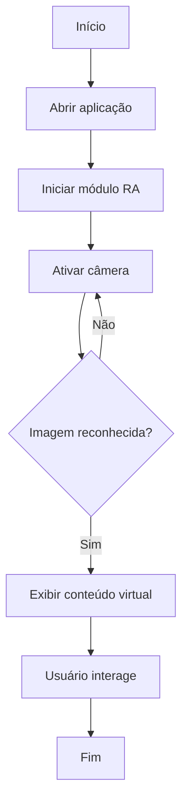

# AR Maintenance Guide

> **Projeto AR Accademy — UPX: Realidade Aumentada**  
> Repositório sobre o modelo AR accademy para B'Energy desenvolvido pelo Grupo Overlay para capacitação e aprendizado na manutenção da placa PCB usando Realidade Aumentada


---

## 1. Identificação do Projeto

| Item | Informação |
|---|---|
| **Projeto** | B'Energy AR accademy |
| **Equipe** | Overlay |
| **Curso** | Engenharia da computação |
| **Disciplina** | UPX — Realidade Aumentada |
| **Professor** | Daniel Ohata |
| **Semestre** | 2026.2 |

### Integrantes

| Nome | RA | Responsabilidade |
|---|---|---|
| Felipe Roberto| 226752 | Desenvolvimento, Planejamento|
| Felipe Veronezzi | 252628 | Documentação, Planejamento |
| Gabriel Verlangieri | 222709 | Desenvolvimento,  X|
| André Vinicius | 236811 | Testes|
| Pedro Henrique | 236519 | Documentação, Planejamento |
| Gabriel Queiroz | 212065 | Testes |
| Matheus Rodrigues | 235959 | Documentação |
| Luis Felipe | 222287 | Desenvolvimento |

---

## 2. Visão Geral

O **B’Energy AR Academy** é um projeto acadêmico de aplicação móvel desenvolvido em React Native que utiliza Realidade Aumentada (RA) e QR Codes para dar suporte ao treinamento de trainees da equipe B’Energy Racing (FACENS) no desenvolvimento de veículos elétricos para a competição Fórmula SAE.

A proposta consiste em utilizar a câmera de um dispositivo móvel para reconhecer marcadores (QR Codes) posicionados junto aos componentes físicos do veículo e das placas eletrônicas (PCB/PCA). 

Após o reconhecimento, a aplicação apresenta informações técnicas sobre as funções dos componentes, orientações de segurança, questionários de fixação e um roteiro guiado de verificação de placas em quatro etapas (qualidade de soldagem, continuidade/curto-circuito, energização Bring UP e testes de integração).

Este repositório reúne a estrutura do Produto Mínimo Viável (MVP) do aplicativo, focado inicialmente no setor de Low Voltage & Data Acquisition. 
O projeto visa aproximar a teoria da prática no ambiente de oficina, proporcionando maior autonomia de aprendizado aos novos estudantes e reduzindo a dependência constante de membros veteranos.


---

## 3. Problema

O treinamento inicial de trainees e a verificação de sistemas técnicos frequentemente dependem de documentações extensas e da supervisão constante de membros veteranos, o que dificulta a associação direta entre o conteúdo teórico e os componentes físicos do veículo.

O B’Energy AR Academy soluciona esse problema ao utilizar Realidade Aumentada e QR Codes em dispositivos móveis para projetar orientações técnicas, avisos de segurança e roteiros de inspeção de placas eletrônicas (PCB) diretamente sobre as peças físicas.

Dessa forma, a aplicação aproxima a informação técnica do seu ponto de uso de maneira simples, promovendo a autonomia dos estudantes no aprendizado e reduzindo dúvidas operacionais no ambiente de oficina.

---

## 4. Objetivos

### 4.1 Objetivo Geral

Desenvolver uma aplicação de Realidade Aumentada capaz de reconhecer uma referência visual e apresentar informações virtuais relacionadas ao objeto identificado.

### 4.2 Objetivos Técnicos

- Configurar um projeto Unity com suporte a Realidade Aumentada.
- Utilizar AR Foundation como camada de integração.
- Realizar reconhecimento de uma imagem cadastrada.
- Instanciar um objeto 3D associado à imagem reconhecida.
- Permitir interação básica com o conteúdo virtual.
- Executar e testar a aplicação em um dispositivo móvel.
- Documentar instalação, execução, testes e limitações.

---

## 5. Público-Alvo

O B’Energy AR Academy é destinado aos trainees da equipe B’Energy Racing (FACENS), especialmente do setor de Low Voltage & Data Acquisition, que necessitam de orientação prática para inspecionar placas eletrônicas e realizar testes de validação e integração em veículos elétricos.

## 6. Funcionalidades

| ID | Funcionalidade | Descrição | Status |
|---|---|---|---|
| RF01 | Guia de soldagem | Exibe referências visuais para identificar soldas defeituosas em PCBs. | 🚧 |
| RF02 | Guia de continuidade | Destaca pontos de medição e circuitos para testes com multímetro. | 🚧 |
| RF03 | Guia de energização | Orienta o processo de Bring UP e indica o comportamento esperado dos LEDs. | 🚧 |
| RF04 | Guia de integração | Indica chaves, conectores e componentes utilizados nos testes do veículo. | 🚧 |
| RF05 | Navegação sequencial | Permite avançar e retornar entre as quatro etapas de inspeção. | 🚧 |
| RF06 | Checklist de validação | Exibe critérios de aprovação e instrumentos necessários para cada etapa. | 🚧 |
| RF07 | Registro de medições | Permite inserir valores de tensão e outras medições realizadas pelo trainee, conforme solicitado durante as etapas de inspeção e validação. | 🚧 |

**Legenda:** ✅ Implementado · 🚧 Em desenvolvimento · ⬜ Planejado · ❌ Cancelado
## 7. Requisitos Não Funcionais

| ID | Categoria | Requisito |
|---|---|---|
| RNF01 | Usabilidade | A interface deve ser intuitiva e dispensar treinamentos extensos. |
| RNF02 | Ergonomia | Deve permitir o uso em suportes de bancada, mantendo as mãos livres para a inspeção. |
| RNF03 | Clareza visual | As indicações devem apresentar contraste e legibilidade adequados à iluminação da bancada. |
| RNF04 | Desempenho | O reconhecimento de QR Codes e marcadores deve ocorrer rapidamente. |
| RNF05 | Rastreamento | As indicações de RA devem permanecer alinhadas aos pontos correspondentes da PCB. |
| RNF06 | Compatibilidade | A aplicação deve funcionar em dispositivos móveis compatíveis com a tecnologia de RA utilizada. |
| RNF07 | Processamento | O MVP deve priorizar textos, imagens e elementos visuais leves, evitando modelos 3D pesados. |
| RNF08 | Manutenibilidade | A estrutura deve facilitar a inclusão de novas rotinas e componentes. |
| RNF09 | Avaliação | O sistema deve permitir registrar métricas de uso, etapas concluídas e erros durante o treinamento. |

## 8. Tecnologias Utilizadas

| Tecnologia | Versão | Utilização |
|---|---|---|
| Unity | 6000.3.25f1 | Desenvolvimento principal |
| C# | Compatível com Unity 6000.3.25f1 | Scripts da aplicação |
| AR Foundation | 6.3.5 | Camada de abstração de Realidade Aumentada |
| ARCore XR Plugin | 6.3.5 | Recursos de Realidade Aumentada em Android |
| ARKit XR Plugin | 6.3.5 | Recursos de Realidade Aumentada em iOS |
| XR Plugin Management | 4.6.1 | Gerenciamento de plugins XR |
| Blender | 4.x | Modelagem/edição 3D |
| Git | 2.x | Controle de versão |
| GitHub | — | Hospedagem do projeto e documentação |

---

## 9. Hardware Utilizado

| Equipamento | Modelo | Característica relevante | Utilização |
|---|---|---|---|
| Smartphone | Preencher | Suporte ao ARCore | Execução e testes |
| Computador | Preencher | CPU, RAM, GPU | Desenvolvimento |

---

## 10. Arquitetura do Sistema

A arquitetura de exemplo está organizada em camadas simples: interface, aplicação, módulo de RA, framework XR e hardware do dispositivo.


### Fluxo resumido

```text
Usuário
   ↓
Interface da Aplicação
   ↓
Controle da Experiência
   ↓
AR Foundation
   ↓
ARCore
   ↓
Câmera / Sensores
   ↓
Ambiente Físico
```

---

## 11. Funcionamento da Realidade Aumentada

### 11.1 Técnica utilizada

Neste exemplo é utilizado **Image Tracking**, no qual uma imagem previamente cadastrada funciona como referência para ativar o conteúdo virtual.

### 11.2 Fluxo técnico


1. A aplicação inicia a câmera do dispositivo.
2. O módulo de RA analisa continuamente as imagens capturadas.
3. O sistema compara a imagem observada com a biblioteca de referências.
4. Quando há correspondência, a posição da referência é obtida.
5. O conteúdo virtual é instanciado e associado à posição reconhecida.
6. O usuário visualiza e interage com a informação virtual.

### 11.3 Elementos virtuais

- modelo 3D;
- texto de orientação;
- destaque visual;
- botão de ação;
- indicação de status.

---

## 12. Estrutura do Projeto

```text
upx-ra-repositorio-modelo/
│
├── Assets/
│   ├── Materials/
│   ├── Models/
│   ├── Prefabs/
│   ├── Scenes/
│   ├── Scripts/
│   └── Textures/
│
├── Packages/
├── ProjectSettings/
│
├── docs/
│   ├── diagrams/
│   ├── documents/
│   └── images/
│
├── .gitignore
├── CHANGELOG.md
├── README.md
└── README-PREENCHIMENTO.md
```

### Pastas principais

| Pasta | Finalidade |
|---|---|
| `Assets/Scripts` | Scripts produzidos pela equipe |
| `Assets/Scenes` | Cenas da aplicação |
| `Assets/Models` | Modelos 3D |
| `Assets/Prefabs` | Objetos reutilizáveis |
| `docs/diagrams` | Diagramas técnicos |
| `docs/images` | Screenshots e figuras |
| `docs/documents` | Documentos complementares |

---

## 13. Principais Scripts

| Script | Responsabilidade |
|---|---|
| `ImageTrackingController.cs` | Controla eventos de reconhecimento de imagens |
| `ARContentManager.cs` | Ativa ou instancia conteúdo virtual |
| `InteractionController.cs` | Exemplo de ponto de extensão para interação |

Os arquivos demonstrativos estão em `Assets/Scripts/`.

---

## 14. Dependências

Exemplo de dependências esperadas:

```text
AR Foundation 6.x
ARCore XR Plugin 6.x
XR Plugin Management 4.x
TextMeshPro 3.x
```

A equipe deverá atualizar esta seção com as versões reais presentes em seu projeto.

---

## 15. Configuração do Ambiente

### Pré-requisitos de exemplo

- Windows 10 ou 11;
- Unity Hub;
- versão do Unity utilizada pela equipe;
- Android Build Support;
- Android SDK/NDK quando necessário;
- Git;
- dispositivo compatível com a tecnologia escolhida.

### Procedimento

1. Instale o Unity Hub.
2. Instale a versão do Unity indicada no README.
3. Inclua os módulos necessários para a plataforma de destino.
4. Instale o Git.
5. Clone o repositório.
6. Abra o projeto pelo Unity Hub.
7. Aguarde a importação das dependências.
8. Verifique as configurações de XR antes da primeira execução.

---

## 16. Como Executar

```bash
git clone https://github.com/USUARIO/REPOSITORIO.git
cd REPOSITORIO
```

Depois:

1. Abra o Unity Hub.
2. Clique em **Add / Open Project**.
3. Selecione a pasta clonada.
4. Confirme a versão correta do Unity.
5. Abra a cena principal do projeto.
6. Verifique a plataforma em **Build Settings / Build Profiles**.
7. Conecte um dispositivo compatível.
8. Execute **Build and Run**.

> A equipe deve adaptar esse passo a passo à tecnologia realmente utilizada.

---

## 17. Como Utilizar a Aplicação

1. Abra a aplicação no dispositivo.
2. Autorize o acesso à câmera.
3. Selecione **Iniciar RA**.
4. Aponte a câmera para a imagem de referência.
5. Aguarde o reconhecimento.
6. Observe o conteúdo virtual exibido.
7. Utilize os controles disponíveis.


---

## 18. Fluxo de Funcionamento



---

## 19. Caso de Uso

O diagrama abaixo representa apenas um exemplo simplificado de interação.


---

## 20. Fluxo de Navegação

```text
Tela Inicial
    ↓
Iniciar RA
    ↓
Câmera
    ↓
Reconhecimento
    ↓
Conteúdo Virtual
    ↓
Interação
```

---

## 21. Interface

Armazene screenshots reais do projeto em `docs/images/`.

Exemplo de organização:

```text
docs/images/
├── tela-inicial.png
├── experiencia-ra.png
└── resultado-teste.png
```

Neste modelo, foi incluída uma figura ilustrativa:


---

## 22. Testes Técnicos

| Teste | Procedimento | Resultado esperado | Resultado obtido | Status |
|---|---|---|---|---|
| Inicialização | Abrir aplicativo | Aplicação inicia | Exemplo | ✅ |
| Câmera | Iniciar módulo RA | Câmera é ativada | Exemplo | ✅ |
| Image Tracking | Apontar referência | Imagem é detectada | Exemplo | ✅ |
| Conteúdo 3D | Reconhecer referência | Objeto é exibido | Exemplo | 🚧 |

> Substitua os resultados de exemplo por evidências reais.

---

## 23. Dispositivos Testados

| Dispositivo | Sistema | Versão | Resultado |
|---|---|---|---|
| Preencher | Android | Preencher | Preencher |

---

## 24. Limitações Conhecidas

Exemplos de limitações que devem ser registradas quando aplicáveis:

- reconhecimento afetado por iluminação inadequada;
- necessidade de manter a referência visível;
- suporte limitado a determinados dispositivos;
- modelos 3D ainda não otimizados;
- funcionalidades planejadas ainda não implementadas.

---

## 25. Evidências de Funcionamento

A equipe deverá incluir:

- pelo menos uma captura de tela do projeto em execução;
- uma imagem ou vídeo da experiência RA;
- quando possível, um vídeo demonstrativo publicado.

Exemplo:

```markdown
[Assistir demonstração](COLE_AQUI_O_LINK_DO_VIDEO)
```

---

## 26. Repositórios e Recursos

| Recurso | Link |
|---|---|
| Código-fonte | Inserir URL |
| Figma | Inserir URL |
| Trello/Jira | Inserir URL |
| Vídeo | Inserir URL |
| Documentação complementar | Inserir URL |

---

## 27. Cronograma Técnico

| Atividade | Responsável | Status |
|---|---|---|
| Configuração do projeto | Aluno 1 | ✅ |
| Implementação RA | Aluno 1 | 🚧 |
| Interface | Aluno 2 | 🚧 |
| Modelos 3D | Aluno 3 | 🚧 |
| Testes | Equipe | ⬜ |
| Documentação | Equipe | 🚧 |

---

## 28. Controle de Versão

Exemplos de mensagens de commit:

```text
feat: adiciona reconhecimento de imagem
fix: corrige posicionamento do objeto virtual
docs: atualiza instruções de execução
test: registra teste em dispositivo Android
```

A equipe deverá evitar concentrar todo o desenvolvimento em um único commit.

---

## 29. Problemas Encontrados e Soluções

### Problema 1 — Conteúdo virtual não aparece

**Problema:** o objeto virtual não é exibido após o reconhecimento.  
**Causa:** referência ou prefab não associado corretamente.  
**Solução:** revisar a biblioteca de imagens e a associação do conteúdo virtual.

### Problema 2 — Perda de tracking

**Problema:** o conteúdo fica instável em determinadas condições.  
**Causa:** baixa iluminação ou referência pouco distinta.  
**Solução:** melhorar as condições de captura e revisar a imagem de referência.

---

## 30. Melhorias Futuras

- adicionar novos objetos de referência;
- melhorar a interação com conteúdo 3D;
- registrar métricas de utilização;
- ampliar compatibilidade;
- adicionar persistência de dados;
- melhorar a interface.

---

## 31. Custos e Recursos

| Recurso | Tipo | Custo/Condição |
|---|---|---|
| Unity | Software | Conforme licença utilizada |
| Blender | Software | Gratuito |
| Smartphone | Hardware | Equipamento da equipe |
| Computador | Hardware | Equipamento da equipe |

---

## 32. Licença

Projeto acadêmico desenvolvido para fins educacionais na disciplina de UPX — Realidade Aumentada.

Caso a equipe utilize uma licença formal de software, substitua este texto e inclua o arquivo `LICENSE` correspondente.

---

## 33. Autores

- **Aluno 1** — desenvolvimento RA
- **Aluno 2** — interface e documentação
- **Aluno 3** — modelos 3D

**Instituição:** UniFacens  
**Disciplina:** UPX — Realidade Aumentada  
**Semestre:** 2026.2

---

## Checklist de Entrega

- [ ] Código-fonte atualizado
- [ ] README completamente preenchido
- [ ] Versões das tecnologias registradas
- [ ] Arquitetura apresentada
- [ ] Funcionamento da RA explicado
- [ ] Estrutura de pastas documentada
- [ ] Scripts principais descritos
- [ ] Procedimento de instalação testado
- [ ] Procedimento de execução testado
- [ ] Screenshots reais adicionados
- [ ] Testes registrados
- [ ] Dispositivos testados informados
- [ ] Limitações conhecidas documentadas
- [ ] Evidência de funcionamento adicionada
- [ ] Commits representam a evolução do projeto

---

> **Orientação final:** este repositório é um modelo. O trabalho da equipe deve substituir exemplos genéricos por conteúdo real, técnico, verificável e atualizado.
